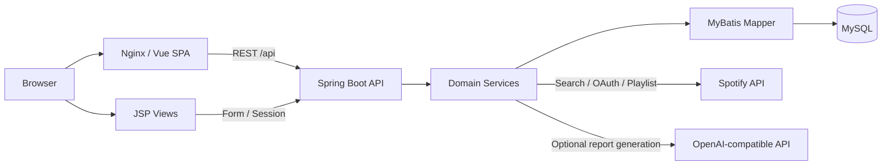
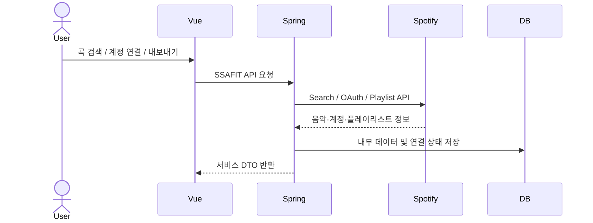
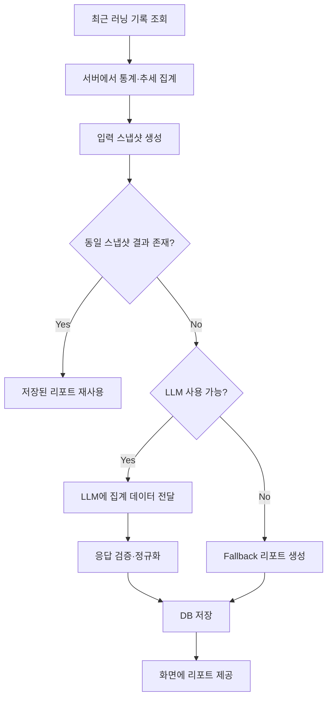
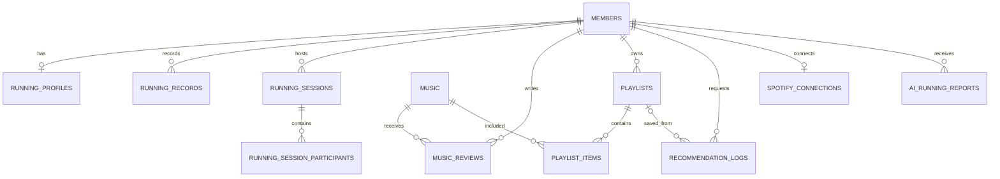

# SSAFIT PlayList

러닝 기록과 음악 데이터를 연결해 운동 조건에 맞는 음악을 추천하고, 추천 결과를 플레이리스트로 저장해 Spotify까지 이어주는 러닝 음악 큐레이션 서비스입니다. 러닝 기록은 AI 리포트를 통해 수치 목록이 아닌 해석 가능한 정보로 확인할 수 있습니다.

## 1. 프로젝트 개요

| 항목 | 내용 |
| --- | --- |
| 프로젝트 | SSAFIT PlayList |
| 기간 | 2026.06.22 ~ 2026.06.26 |
| 형태 | SSAFY 관통 프로젝트 |
| 핵심 주제 | 러닝 데이터 기반 음악 추천 및 플레이리스트 관리 |
| 주요 연동 | Spotify Web API, OpenAI-compatible API |
| 실행 환경 | Docker Compose 기반 MySQL / Spring Boot / Vue·Nginx 구성 |

서비스의 핵심 흐름은 다음과 같습니다.

```text
회원가입·로그인
→ 러닝 프로필 및 기록 관리
→ 음악 탐색·리뷰
→ 러닝 조건 기반 음악 추천
→ 추천 결과 플레이리스트 저장
→ Spotify 계정 연결 및 플레이리스트 내보내기
→ 러닝 기록 기반 AI 리포트 확인
```

## 2. 기획 의도

러닝 중 음악을 고를 때 사용자는 운동 강도, 케이던스, 선호 장르와 음악의 템포를 함께 고려하게 됩니다. 하지만 러닝 기록과 음악 탐색은 서로 다른 서비스에 분리되어 있고, 기록이 쌓여도 다음 운동이나 음악 선택에 바로 활용하기 어렵습니다.

SSAFIT PlayList는 이 간극을 줄이는 것을 목표로 설계했습니다.

- 러닝 프로필과 러닝 기록을 음악 추천의 입력으로 연결합니다.
- 케이던스, 운동 강도, 음악 BPM, 사용자 선호를 함께 고려해 추천 결과를 계산합니다.
- 추천 결과를 일회성 화면으로 끝내지 않고 내부 플레이리스트로 저장합니다.
- Spotify OAuth를 통해 내부 플레이리스트를 외부 음악 서비스로 내보낼 수 있습니다.
- 거리, 시간, 페이스, 케이던스, 심박처럼 숫자로 쌓이는 러닝 기록은 AI 리포트로 요약합니다.
- 외부 API나 LLM을 사용할 수 없는 상황에서도 핵심 흐름이 중단되지 않도록 대체 경로를 둡니다.

## 3. 주요 기능

### 회원 및 러닝 데이터

- 회원가입, 로그인, 로그아웃
- HttpSession 기반 인증
- 러닝 프로필 관리
- 러닝 기록 등록·조회·수정
- 러닝 세션 생성 및 참여

### 음악 및 플레이리스트

- 음악 목록, 검색, 상세 조회
- 음악 리뷰 등록·수정·삭제
- 플레이리스트 생성·조회·수정·삭제
- 수록곡 추가·삭제·순서 변경
- 플레이리스트 저장 및 추천 결과 저장

### 러닝 조건 기반 추천

- 목표 케이던스와 음악 BPM 간 템포 매칭
- 운동 강도와 음악 에너지 수준 매칭
- 사용자 리뷰 기반 선호 점수 반영
- 입력 데이터가 일부 부족해도 사용 가능한 항목만으로 점수를 재계산

### Spotify 연동

- Spotify 곡 검색 및 내부 음악 저장
- OAuth 기반 사용자 계정 연결
- Spotify 플레이리스트 조회 및 가져오기
- 내부 플레이리스트를 Spotify 계정으로 내보내기
- 토큰 만료 시 Refresh Token 기반 갱신

### AI 러닝 리포트

- 최근 러닝 기록 집계
- 거리, 시간, 페이스, 케이던스, 심박 추세 정리
- 집계 데이터를 기반으로 자연어 리포트 생성
- 동일 입력 스냅샷에 대한 저장 결과 재사용
- 외부 LLM 비활성화·호출 실패·데이터 부족 시 fallback 리포트 제공

## 4. 기술 스택

| 영역 | 기술 |
| --- | --- |
| Backend | Java 25, Spring Boot 4.0.6, Spring MVC, Maven |
| Persistence | MyBatis 4.0.1, MySQL 8 |
| Frontend | Vue 3, Vite 6, Vue Router 4, Axios |
| Server-side View | JSP, JSTL |
| Authentication | HttpSession |
| External API | Spotify Web API / Accounts API, OpenAI-compatible Responses API |
| Test | JUnit, Spring Boot Test, MySQL Mapper Integration Test, Playwright |
| Runtime | Docker Compose, Nginx, Node.js 22 |

## 5. 시스템 아키텍처



Docker 환경에서는 Nginx가 Vue 정적 파일을 제공하고, `/api`, `/login`, `/join`, `/members/*` 요청을 Spring Boot로 프록시합니다. 회원 인증 화면 일부는 JSP, 주요 기능 화면은 Vue로 구성되어 있으며 두 화면 계층은 동일한 HttpSession을 사용합니다.

백엔드는 도메인별로 Controller → Service → Mapper → MySQL 흐름을 사용합니다. Spotify와 AI 연동도 Service 계층에서 처리해 브라우저가 외부 서비스의 Client Secret이나 API Key를 직접 다루지 않도록 분리했습니다.

## 6. 추천 로직

추천에서는 서로 의미가 다른 세 가지 데이터를 구분합니다.

- 음악 BPM: 곡의 템포
- 케이던스 SPM: 러닝 중 발걸음 빈도
- 심박 BPM: 운동 중 생리 반응

심박을 음악 BPM과 직접 대응시키지 않고, 추천 점수는 다음 세 축으로 계산합니다.

| 기준 | 기본 가중치 | 설명 |
| --- | ---: | --- |
| 케이던스 매칭 | 0.60 | 목표 케이던스와 음악 BPM의 direct / half-time 차이 평가 |
| 운동 강도 매칭 | 0.30 | 요청 강도와 음악 에너지 수준의 적합도 |
| 사용자 선호 | 0.10 | 개인 리뷰 점수, 없으면 전체 평균 또는 중립값 |

음악 BPM이나 에너지 정보가 없을 때 해당 항목을 0점으로 처리하지 않습니다. 사용 가능한 점수의 가중치만 다시 정규화해 일부 메타데이터 누락이 전체 추천을 과도하게 낮추지 않도록 구성했습니다.

상세 설계는 [추천 설계](docs/recommendation-design.md)에 정리되어 있습니다.

## 7. 외부 서비스 연동

### Spotify



Spotify API는 곡 검색, 사용자 OAuth, 플레이리스트 가져오기와 내보내기에 사용합니다. Frontend는 Spotify API를 직접 호출하지 않고 Spring Boot API를 통해 접근합니다.

외부 API 특성상 BPM이나 장르 정보가 항상 제공되는 것은 아니므로, 보강 데이터가 없을 때는 `null`을 허용하고 해당 정보 없이도 나머지 기능이 동작하도록 처리했습니다.

### AI 러닝 리포트



LLM이 수치를 직접 계산하도록 맡기지 않고 서버에서 먼저 러닝 데이터를 집계합니다. LLM에는 회원 ID, 이메일, 닉네임 같은 식별 정보를 제외한 집계 스냅샷을 전달하며, 호출 실패나 데이터 부족 시 fallback 경로를 사용합니다.

상세 내용은 [AI 러닝 리포트](docs/ai-running-report.md)에서 확인할 수 있습니다.

## 8. 데이터 구조

주요 데이터 관계는 다음과 같습니다.



전체 스키마와 제약조건은 `ssafit/src/main/resources/sql/schema.sql`에서 확인할 수 있으며, ERD 원본은 [데이터 모델](docs/data-model.md)에 정리되어 있습니다.

## 9. 프로젝트 구조

```text
SSAFIT_Playlist/
├─ frontend/                       # Vue 3 Frontend
│  ├─ src/
│  │  ├─ api/
│  │  ├─ components/
│  │  ├─ router/
│  │  └─ views/
│  ├─ package.json
│  └─ package-lock.json
│
├─ ssafit/                         # Spring Boot Backend
│  ├─ src/main/java/com/ssafy/ssafit/
│  │  ├─ member/
│  │  ├─ music/
│  │  ├─ musicreview/
│  │  ├─ playlist/
│  │  ├─ recommendation/
│  │  ├─ runningprofile/
│  │  ├─ runningrecord/
│  │  ├─ runningsession/
│  │  ├─ spotify/
│  │  └─ airunningreport/
│  └─ src/main/resources/
│     ├─ mappers/
│     └─ sql/
│
├─ docs/                           # 설계·검증·연동 문서
├─ compose.yaml
├─ .env.example
└─ README.md
```

## 10. 실행 방법

가장 간단한 실행 방법은 Docker Compose입니다.

### 1. 환경 파일 준비

```bash
cp .env.example .env
```

Windows PowerShell:

```powershell
Copy-Item .env.example .env
```

최소한 다음 DB 비밀번호를 로컬 `.env`에 설정합니다.

```text
MYSQL_PASSWORD=<local-password>
MYSQL_ROOT_PASSWORD=<local-root-password>
SSAFIT_DB_PASSWORD=<same-as-MYSQL_PASSWORD>
```

Spotify 또는 외부 LLM 기능을 사용할 경우에만 관련 환경변수를 추가로 설정합니다. `.env`는 Git에 커밋하지 않습니다.

### 2. 컨테이너 실행

```bash
docker compose up -d --build
```

### 3. 접속

```text
http://127.0.0.1:5173
```

상세한 로컬 개발 환경과 환경변수 설정은 [프로젝트 문서](docs/README.md)를 참고합니다.

## 11. 테스트

Backend:

```bash
cd ssafit
./mvnw test
```

Windows:

```powershell
cd ssafit
.\mvnw.cmd test
```

Frontend:

```bash
cd frontend
npm ci
npm run build
npm run e2e
```

프로젝트에는 Service/Controller 단위 테스트, MySQL Mapper 통합 테스트, Playwright 기반 E2E 테스트가 포함되어 있습니다.

## 12. 현재 범위와 한계

- 인증은 JWT가 아니라 HttpSession 기반입니다.
- Spotify의 BPM·장르 보강 정보는 외부 API 정책과 응답 가능성에 따라 없을 수 있습니다.
- AI 러닝 리포트의 외부 LLM 호출은 기본 설정에서 비활성화되어 있으며, API Key와 환경변수를 설정해야 활성화됩니다.
- 외부 LLM을 사용할 수 없거나 데이터가 부족할 때는 서버 fallback 결과를 제공합니다.
- Spotify Access Token과 Refresh Token은 DB에 저장됩니다. 운영 환경으로 확장한다면 애플리케이션 수준 암호화 또는 별도 비밀 관리 체계를 추가해야 합니다.

## 13. 관련 문서

- [문서 인덱스](docs/README.md)
- [시스템 아키텍처](docs/architecture.md)
- [데이터 모델](docs/data-model.md)
- [추천 설계](docs/recommendation-design.md)
- [Spotify 연동](docs/spotify-integration.md)
- [AI 러닝 리포트](docs/ai-running-report.md)
- [테스트 전략](docs/testing.md)