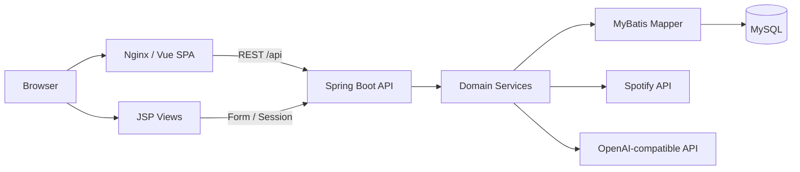
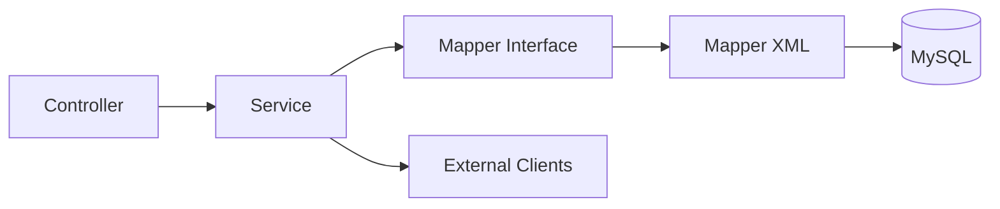
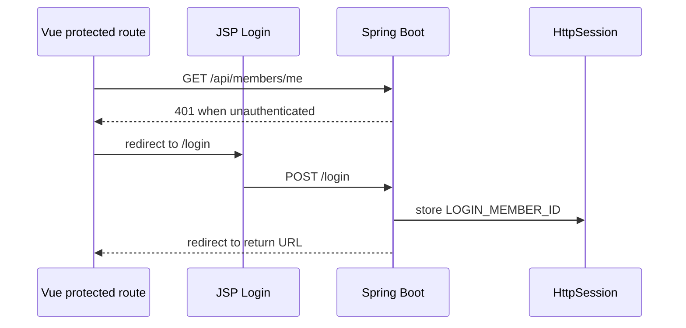
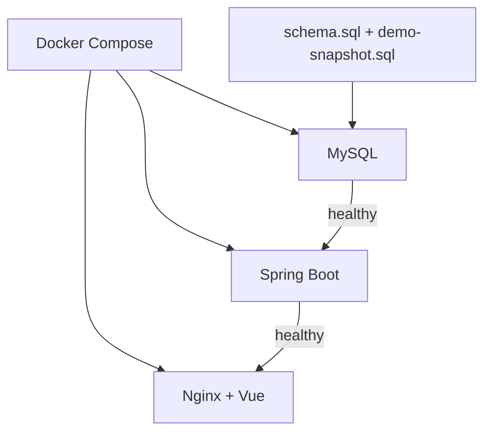

# System Architecture

## Overview

SSAFIT PlayList는 Vue 기반 기능 화면과 JSP 기반 회원 화면이 공존하는 구조입니다. 브라우저 요청은 Nginx와 Spring Boot를 통해 처리되며, Backend는 MyBatis를 이용해 MySQL에 접근합니다. Spotify와 생성형 AI 연동은 Backend Service 계층에서 수행합니다.



## Backend Layers



주요 도메인은 다음과 같습니다.

- `member`: 회원·세션 인증
- `music`, `musicreview`: 음악과 리뷰
- `playlist`: 플레이리스트·수록곡·저장
- `runningprofile`, `runningrecord`, `runningsession`: 러닝 데이터
- `recommendation`: 러닝 조건 기반 추천
- `spotify`: 음악 검색·OAuth·Import/Export
- `airunningreport`: AI 러닝 리포트
- `common`: 예외·응답·공통 설정

## Authentication

프로젝트 인증은 JWT가 아니라 `HttpSession` 기반입니다.



Vue API 요청은 세션 쿠키를 사용하며, JSP 회원 화면과 Vue 기능 화면이 같은 로그인 상태를 공유합니다.

## Runtime

Docker Compose는 세 서비스를 구성합니다.

- `mysql`: MySQL 8.4.4
- `backend`: Java 25 / Spring Boot
- `frontend`: Vue build 결과를 Nginx로 제공



## Request Examples

### Recommendation

```text
RecommendationView
→ recommendationApi
→ RecommendationApiController
→ RecommendationService
→ Music / Review / Running data
→ recommendation_logs
```

### Spotify Export

```text
Playlist 화면
→ Spring Boot API
→ Spotify 연결 확인·토큰 갱신
→ Spotify Playlist 생성
→ 수록곡 추가
→ Export 상태 저장
```

### AI Running Report

```text
RunningRecordListView
→ AiRunningReportApiController
→ AggregationService
→ GenerationService
→ LLM Provider 또는 Fallback
→ ai_running_reports 저장
```
