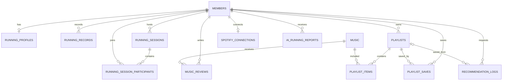

# Data Model

## Core ERD

## Main Tables

| Domain | Tables | Purpose |
| --- | --- | --- |
| Member | `members`, `running_profiles` | 회원과 러닝 개인화 정보 |
| Running | `running_records`, `running_sessions`, `running_session_participants` | 러닝 기록과 세션 |
| Music | `music`, `music_reviews` | 음악 메타데이터와 사용자 평가 |
| Playlist | `playlists`, `playlist_items`, `playlist_saves` | 플레이리스트 구성과 저장 |
| Recommendation | `recommendation_logs` | 추천 요청과 저장 결과 추적 |
| Spotify | `spotify_connections` | 회원별 Spotify 연결 정보 |
| AI Report | `ai_running_reports` | 입력 스냅샷과 리포트 결과 |

## Data Boundaries

### Music BPM, Cadence, Heart Rate

프로젝트에서는 의미가 다른 세 값을 분리합니다.

- `music.bpm`: 음악 템포 BPM
- `running_records.average_cadence`: 러닝 케이던스 SPM
- `running_records.average_heart_rate_bpm`: 평균 심박 BPM

심박은 음악 BPM과 직접 대응시키지 않으며 러닝 상태를 설명하는 참고 데이터로 취급합니다.

### Recommendation Log

추천 요청 조건과 결과 요약은 `recommendation_logs`에 저장됩니다. 추천 결과를 플레이리스트로 저장하면 `saved_playlist_id`로 연결합니다.

### Spotify Metadata

`music`에는 Spotify Track ID와 URI를 저장하고, `playlists`에는 Spotify Playlist ID, URL, Export 상태를 저장합니다. 회원별 OAuth 연결은 `spotify_connections`로 분리합니다.

### AI Report Snapshot

`ai_running_reports`는 리포트 결과뿐 아니라 입력 스냅샷과 해시를 저장합니다. 동일한 입력에 대한 결과 재사용과 생성 근거 추적에 활용합니다.

## Constraints

실제 DDL은 `ssafit/src/main/resources/sql/schema.sql`을 기준으로 합니다. 주요 관계에는 FK와 UNIQUE 제약을 사용하며, 일부 상태 값에는 CHECK 제약을 적용합니다.

회원, 플레이리스트, 러닝 기록은 `deleted_at`을 이용한 soft delete 흐름을 포함합니다.
