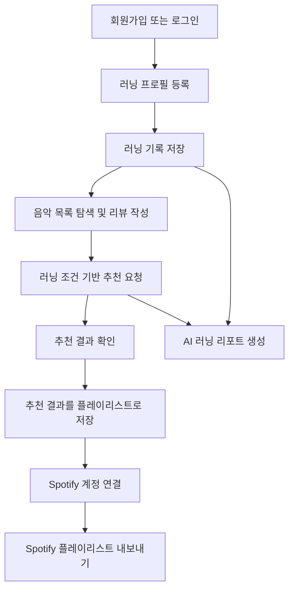
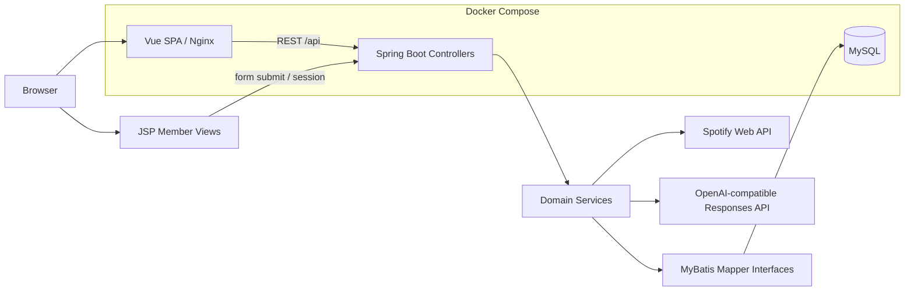
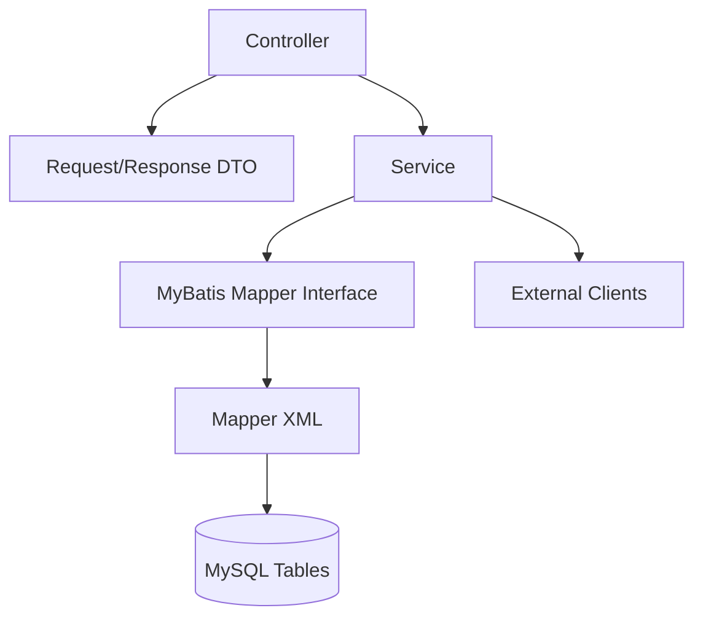

# SSAFIT PlayList 최종 프로젝트 보고서

## 1. 프로젝트 개요

### 1.1 프로젝트명

SSAFIT PlayList

러닝 기록과 음악 데이터를 연결해 사용자의 운동 조건에 맞는 음악을 탐색, 추천, 저장, 외부 서비스로 내보낼 수 있도록 만든 러닝 음악 큐레이션 서비스이다.

### 1.2 프로젝트 기간 및 팀 구성

- 프로젝트 기간: 2026.6.22 ~ 2026.6.26
- 프로젝트 성격: SSAFY 관통 프로젝트 집중 개발
- 팀 구성: 백엔드, 프론트엔드, 외부 API 연동, 테스트 및 문서화 역할을 나누어 진행
- 협업 방식:
  - Spring Boot/MyBatis 기반 도메인, Mapper, Service 구현
  - Vue 화면, JSP 인증 화면, API 연동 구현
  - Spotify, 생성형 AI, Docker 실행 환경 통합
  - 테스트 코드, 통합 테스트, 최종 산출 문서 작성

팀원 이름이나 개인별 상세 역할은 현재 저장소 문서에서 명확히 확인되지 않으므로 본 보고서에는 역할 단위로만 기술한다.

### 1.3 프로젝트 목표

SSAFIT PlayList의 목표는 러닝 사용자가 자신의 운동 조건과 음악 선호를 하나의 서비스 안에서 관리하고, 그 데이터를 바탕으로 러닝에 어울리는 음악과 플레이리스트를 구성하도록 돕는 것이다.

구체적인 목표는 다음과 같다.

- 회원 가입, 로그인, 마이페이지, 러닝 프로필을 통해 개인화 기반을 만든다.
- 음악 목록, 검색, 상세 조회, 리뷰를 통해 음악 선호 데이터를 축적한다.
- 플레이리스트 생성과 수록곡 관리를 통해 사용자가 직접 음악 묶음을 구성한다.
- 러닝 프로필, 러닝 기록, 케이던스, 심박, 운동 강도를 추천 조건으로 활용한다.
- Spotify 검색, OAuth 연결, 플레이리스트 내보내기로 외부 음악 서비스와 연결한다.
- 생성형 AI를 활용해 러닝 기록과 추천 로그를 자연어 리포트로 요약한다.
- Docker 기반으로 MySQL, 백엔드, 프론트엔드를 재현 가능한 실행 환경으로 묶는다.

### 1.4 해결하려는 문제

러닝을 할 때 사용자는 운동 강도, 페이스, 케이던스, 심박, 기분, 선호 장르에 맞는 음악을 선택해야 한다. 그러나 일반 음악 검색 서비스는 러닝 기록과 운동 조건을 직접 고려하지 않으며, 운동 기록 앱은 음악 선택 경험과 연결되지 않는 경우가 많다.

SSAFIT PlayList는 이 간극을 줄이기 위해 다음 문제를 해결하려 했다.

- 러닝 기록과 음악 선택 경험이 분리되어 있는 문제
- 운동 강도와 음악 BPM, 에너지, 장르를 함께 고려하기 어려운 문제
- 추천 결과를 실제 플레이리스트로 저장하고 외부 음악 서비스로 옮기는 흐름이 번거로운 문제
- 러닝 기록을 수치 목록으로만 보는 것이 아니라, 다음 러닝 방향으로 해석하기 어려운 문제

## 2. 서비스 기획

### 2.1 핵심 사용자

| 사용자 | 설명 | 주요 사용 기능 |
| --- | --- | --- |
| 비회원 사용자 | 공개 음악과 서비스 진입 화면을 탐색하는 사용자 | 회원가입, 로그인, 공개 음악 조회 |
| 일반 회원 | 러닝 기록과 음악 선호를 관리하는 사용자 | 음악 리뷰, 플레이리스트, 러닝 프로필, 러닝 기록, 러닝 세션, 추천 |
| Spotify 연동 회원 | Spotify 계정을 연결해 실제 음악 서비스와 연동하려는 사용자 | Spotify 검색, OAuth 연결, 플레이리스트 가져오기/내보내기 |
| 발표/시연 사용자 | 데모 계정과 demo snapshot 데이터로 주요 흐름을 검증하는 사용자 | 핵심 시나리오 실행, 캡처, 테스트 결과 확인 |

### 2.2 핵심 사용자 시나리오

핵심 사용자 흐름은 다음과 같다.

1. 사용자는 JSP 기반 `/join`, `/login` 화면에서 계정을 만들고 로그인한다.
2. 로그인 후 마이페이지와 러닝 프로필 화면에서 개인 정보를 입력한다.
3. Vue 화면에서 음악을 조회하고 리뷰를 작성한다.
4. 러닝 기록을 저장하고 페이스, 케이던스, 심박 데이터를 축적한다.
5. 추천 화면에서 운동 강도, 목표 거리, 장르 조건으로 음악 추천을 받는다.
6. 추천 결과를 플레이리스트로 저장한다.
7. Spotify OAuth를 연결한 뒤 Spotify URI가 있는 곡을 외부 플레이리스트로 내보낸다.
8. 러닝 기록과 추천 로그를 기반으로 AI 러닝 리포트를 생성한다.

### 2.3 차별점

- 음악 서비스와 러닝 기록 서비스를 단순 병렬 배치하지 않고, 추천 로직에서 러닝 데이터와 음악 데이터를 함께 사용한다.
- 케이던스 SPM, 심박 BPM, 음악 tempo BPM을 구분해 도메인 모델과 오류 메시지에서 분리했다.
- 추천 결과를 즉시 플레이리스트로 저장하고, Spotify로 export하는 흐름까지 연결했다.
- Spotify 정책과 API 실패 가능성을 고려해 BPM/장르 보강 실패 시 null 처리 및 로컬 데이터 기반 대체 경로를 마련했다.
- 생성형 AI는 모든 판단을 대신하는 구조가 아니라, 서버가 집계한 데이터를 자연어 리포트와 운동 방향으로 정리하는 보조 기능으로 설계했다.
- Docker Compose로 MySQL, Spring Boot, Vue/Nginx를 한 번에 실행할 수 있는 구조를 만들었다.

### 2.4 서비스 범위

**구현 범위**

- 회원 가입, 로그인, 로그아웃, 마이페이지
- 음악 목록, 검색, 정렬, 상세 조회
- 음악 등록/수정, Spotify 검색 결과 저장
- 음악 리뷰 등록, 수정, 삭제, 평균 조회
- 플레이리스트 CRUD, 수록곡 추가/삭제/순서 변경
- 플레이리스트 저장/취소
- 러닝 프로필, 러닝 기록, 러닝 세션, 참여/취소
- 러닝 조건 기반 음악 추천, 추천 로그 조회/삭제/저장
- Spotify 검색, OAuth 연결, 플레이리스트 조회/가져오기, 내보내기
- AI 러닝 리포트 생성 및 조회
- Docker 기반 실행 환경
- 단위 테스트, Controller 테스트, MySQL 통합 테스트, Playwright E2E 일부

**현재 범위 밖 또는 제한 사항**

- 음악 삭제 API는 확인되지 않는다.
- Spring Security/JWT는 사용하지 않고 Session 기반 인증을 사용한다.
- 관리자 권한 모델은 명확히 구현되어 있지 않다.
- Spotify 실 API 검증은 계정, redirect URI, scope, 개발 모드 설정에 의존한다.
- Spotify BPM/장르/오디오 특성은 API 정책과 응답 가능성에 따라 null이 될 수 있다.
- 생성형 AI 실제 호출은 기본값으로 비활성화되어 있으며, 환경 변수와 API key 설정이 필요하다.

## 3. 시스템 아키텍처

### 3.1 전체 구조

전체 구조는 Vue 기능 화면과 JSP 인증 화면이 공존하는 형태이다. Docker 환경에서는 Nginx가 Vue 정적 파일을 제공하면서 `/api`, `/login`, `/join`, `/members/*` 등을 Spring Boot backend로 프록시한다. 이를 통해 브라우저 입장에서는 `http://127.0.0.1:5173` 중심으로 화면과 API를 접근할 수 있다.

### 3.2 기술 스택

| 영역 | 기술 |
| --- | --- |
| Backend | Java 25, Spring Boot 4.0.6, Maven Wrapper, WAR |
| Web | Spring MVC REST API, JSP, Session 인증 |
| Persistence | MyBatis 4.0.1, MySQL Connector/J, MySQL 8.x |
| Frontend | Vue 3.5, Vite 6, Vue Router 4, Axios |
| Test | JUnit, Spring Boot Test, Mapper Integration Test, Playwright |
| External API | Spotify Web API, OpenAI-compatible Responses API |
| Runtime | Docker Compose, Eclipse Temurin 25, Node 22, Nginx |

### 3.3 프론트엔드 구조

프론트엔드는 `frontend/src/router/index.js`를 중심으로 라우트를 정의한다.

주요 Vue 경로는 다음과 같다.

- `/music`: 음악 목록
- `/music/:musicId`: 음악 상세 및 리뷰
- `/playlists`: 플레이리스트 목록
- `/playlists/new`: 플레이리스트 생성
- `/playlists/:playlistId`: 플레이리스트 상세 및 수록곡 관리
- `/running-records`: 러닝 기록 목록
- `/running-records/new`: 러닝 기록 생성
- `/running-sessions`: 러닝 세션 목록
- `/running-sessions/new`: 러닝 세션 생성
- `/recommendations`: 러닝 조건 기반 추천
- `/oauth/spotify/complete`: Spotify OAuth 완료

프론트엔드 API 모듈은 `frontend/src/api`에 기능별로 분리되어 있다.

- `authApi.js`, `memberApi.js`
- `musicApi.js`, `reviewApi.js`
- `playlistApi.js`, `playlistSaveApi.js`
- `runningProfileApi.js`, `runningRecordApi.js`, `runningSessionApi.js`
- `recommendationApi.js`
- `spotifyApi.js`
- `aiRunningReportApi.js`

JSP 인증 화면과 Vue 기능 화면은 완전히 분리되어 있지 않다. 로그인, 회원가입, 마이페이지, 러닝 프로필 일부는 JSP로 구현되어 있고, Vue Router guard는 보호 라우트 진입 시 `/api/members/me`로 세션을 확인한다.

### 3.4 백엔드 구조

백엔드는 도메인별 Controller, Service, Mapper, Domain/DTO로 구성된다.

주요 패키지는 다음과 같다.

- `member`: 회원, 인증, JSP view controller
- `music`, `musicreview`: 음악과 리뷰
- `playlist`: 플레이리스트, 수록곡, 저장
- `runningprofile`, `runningrecord`, `runningsession`: 러닝 도메인
- `recommendation`: 러닝 조건 기반 추천
- `spotify`: Spotify 검색, OAuth, 가져오기, 내보내기
- `airunningreport`: AI 러닝 리포트
- `common`: 인증, 예외, 응답, 설정

### 3.5 데이터베이스 구조

핵심 테이블은 다음과 같다.

| 도메인 | 주요 테이블 |
| --- | --- |
| 회원 | `members` |
| 러닝 프로필 | `running_profiles` |
| 음악 | `music` |
| 리뷰 | `music_reviews` |
| 플레이리스트 | `playlists`, `playlist_items`, `playlist_saves` |
| 추천 | `recommendation_logs` |
| Spotify | `spotify_connections` |
| AI 리포트 | `ai_running_reports` |
| 러닝 기록/세션 | `running_records`, `running_sessions`, `running_session_participants` |

DB schema는 `ssafit/src/main/resources/sql/schema.sql`에 정의되어 있으며 FK, UNIQUE, CHECK 제약을 사용한다. `demo-snapshot.sql`에는 발표 및 시연용 demo 데이터가 포함되어 있다. 따라서 발표에서 demo 계정을 사용하는 경우 실제 운영 데이터가 아니라 시연용 seed/demo 데이터임을 명시해야 한다.

### 3.6 Docker 기반 실행 환경

Docker Compose는 세 개 서비스를 구성한다.

- `mysql`: MySQL 8.4.4, schema/demo snapshot 초기화
- `backend`: Java 25 기반 Spring Boot WAR 실행
- `frontend`: Vue build 결과를 Nginx로 제공

Docker와 로컬 환경의 차이는 다음과 같다.

| 구분 | 로컬 개발 | Docker |
| --- | --- | --- |
| DB host | `localhost` | `mysql` |
| Backend | `localhost:8080` | container `8080` |
| Frontend | Vite `localhost:5173` | Nginx host port `5173` |
| JSP 접근 | backend 직접 접근 가능 | Nginx가 `/login`, `/join`, `/members/*` 프록시 |
| SQL init | `spring.sql.init.mode=never` | MySQL entrypoint SQL |

## 4. 핵심 기능 구현

### 기능별 구현 상태 요약

| 기능 | 구현 상태 | 근거 |
| --- | --- | --- |
| 회원가입, 로그인, 로그아웃 | 구현 완료 | `MemberViewController`, `MemberApiController`, `AuthApiController`, `AuthService` |
| 마이페이지/회원 정보 조회 | 구현 완료 | `MemberViewController.myPage`, `MemberApiController.me` |
| 음악 목록/검색/상세 | 구현 완료 | `MusicApiController`, `MusicService`, `MusicMapper.xml` |
| 음악 등록/수정 | 구현 완료 | `MusicApiController.createInternalMusic/updateInternalMusic` |
| 음악 삭제 | 미구현 | 삭제 API 확인되지 않음 |
| 음악 리뷰 CRUD | 구현 완료 | `MusicReviewApiController`, `MusicReviewService` |
| 플레이리스트 CRUD | 구현 완료 | `PlaylistApiController`, `PlaylistService` |
| 수록곡 관리 | 구현 완료 | `PlaylistItemApiController`, `PlaylistItemService` |
| 러닝 프로필 | 구현 완료 | `RunningProfileApiController`, `RunningProfileViewController`, `RunningProfileService` |
| 러닝 기록 | 구현 완료 | `RunningRecordApiController`, `RunningRecordService` |
| 러닝 세션/참여 | 구현 완료 | `RunningSessionApiController`, `RunningSessionParticipantService` |
| 러닝 조건 기반 추천 | 구현 완료 | `RecommendationApiController`, `RecommendationService` |
| Spotify 검색 | 부분 구현 | 실제 검색 호출은 있으나 BPM/장르 보강은 외부 API 제한을 받음 |
| Spotify OAuth | 구현 완료 | `SpotifyApiController`, `SpotifyOAuthService` |
| Spotify 내보내기 | 구현 완료 | `PlaylistExportApiController`, `PlaylistExportService` |
| AI 러닝 리포트 | 구현 완료 | 실제 provider 구현 + fallback 구조 |
| 목표 거리 기반 AI 운동 계획 | 부분 구현 | LLM provider가 없으면 서버 계산 fallback |

### 4.1 회원 및 인증

회원 기능은 JSP 화면과 REST API가 함께 존재한다. JSP 화면은 `/join`, `/login`, `/members/me`, `/logout` 흐름을 제공하고, REST API는 `/api/members`, `/api/auth/login`, `/api/auth/logout`, `/api/members/me`를 제공한다.

인증은 Spring Security/JWT가 아니라 `HttpSession` 기반이다. 로그인 성공 시 `SessionConst.LOGIN_MEMBER_ID`에 회원 ID가 저장되고, API와 Vue Router guard는 세션 조회로 로그인 여부를 확인한다.

구현 근거:

- `MemberViewController`
- `MemberApiController`
- `AuthApiController`
- `AuthService`
- `SessionMemberResolver`
- `MemberMapper.xml`

### 4.2 음악 관리 및 리뷰

음악 기능은 목록 조회, 검색, 정렬, 상세 조회, 내부 음악 등록/수정, Spotify 트랙 저장을 지원한다. 다만 음악 삭제 API는 확인되지 않았으므로 “음악 CRUD 전체 구현”으로 표현해서는 안 된다.

리뷰 기능은 음악별 리뷰 조회, 등록, 수정, 삭제를 지원한다. 리뷰는 선호 점수와 러닝 적합도 점수를 포함하며, `music_reviews` 테이블에 저장된다.

구현 근거:

- `MusicApiController`
- `MusicService`
- `MusicMapper.xml`
- `MusicReviewApiController`
- `MusicReviewService`
- `MusicReviewMapper.xml`
- `MusicListView.vue`, `MusicDetailView.vue`, `MusicReviewForm.vue`

### 4.3 플레이리스트 관리

플레이리스트는 사용자 생성, 조회, 수정, 삭제를 지원한다. 수록곡은 추가, 삭제, 단건 순서 변경, 일괄 순서 변경 API가 구현되어 있다. 플레이리스트 저장/취소 기능도 별도 API로 제공된다.

추천 결과는 `USER + CURATION_COPY` 성격의 플레이리스트로 저장되며, 추천 로그의 `saved_playlist_id`와 연결된다.

구현 근거:

- `PlaylistApiController`
- `PlaylistItemApiController`
- `PlaylistSaveApiController`
- `PlaylistService`
- `PlaylistItemService`
- `PlaylistSaveService`
- `PlaylistMapper.xml`, `PlaylistItemMapper.xml`, `PlaylistSaveMapper.xml`

### 4.4 러닝 프로필 및 러닝 기록

러닝 프로필은 회원별 성별, 나이, 선호 장르, 목표 심박/케이던스 정보를 다룬다. 나이가 입력되면 추정 최대 심박이 계산된다. 러닝 기록은 날짜, 거리, 시간, 케이던스, 평균 심박, 메모를 저장하며, 거리와 시간을 바탕으로 페이스를 계산한다.

러닝 기록 저장 또는 수정 후에는 러닝 프로필의 자동 목표값을 갱신하는 흐름이 구현되어 있다.

구현 근거:

- `RunningProfileApiController`
- `RunningProfileViewController`
- `RunningProfileService`
- `RunningFitnessMetricService`
- `RunningRecordApiController`
- `RunningRecordService`
- `RunningProfileMapper.xml`, `RunningRecordMapper.xml`

### 4.5 운동 조건 기반 음악 추천

추천 기능은 러닝 강도, 목표 거리, 목표 케이던스, 장르, 러닝 프로필, 최근 러닝 기록, 음악 BPM/에너지 정보를 활용한다. 추천 조회 시 결과와 추천 로그가 저장되며, 사용자가 저장을 요청하면 플레이리스트와 수록곡으로 복사된다.

추천 로직은 다음 요소를 반영한다.

- 음악 BPM과 목표 케이던스의 tempo match
- 운동 강도와 음악 에너지 매칭
- 선호 장르
- 사용자 리뷰 기반 선호 점수
- 목표 거리 입력 시 운동 계획과 구간별 BPM 범위

구현 근거:

- `RecommendationApiController`
- `RecommendationService.recommend`
- `RecommendationService.saveRecommendation`
- `CadenceResolutionService`
- `RunningIntensityResolutionService`
- `CadenceMatchingPolicy`
- `IntensityMatchingPolicy`
- `RecommendationLogMapper.xml`

### 4.6 Spotify 연동

Spotify 연동은 실제 Web API 호출 구조를 포함한다.

구현된 기능:

- Client Credentials 기반 트랙 검색
- 트랙 검색 결과를 내부 음악으로 저장
- OAuth authorization URL 생성
- OAuth callback 처리
- Access Token/Refresh Token 저장 및 갱신
- 현재 사용자 프로필 조회
- 내 Spotify 플레이리스트 조회
- Spotify 플레이리스트 가져오기
- SSAFIT 플레이리스트를 Spotify 플레이리스트로 내보내기

제약 사항:

- Spotify Search API는 BPM/장르 조건 검색 API가 아니다.
- tempo와 genre는 별도 API 조회를 시도하지만 실패 시 null로 처리된다.
- Spotify URI가 없는 수록곡은 export에서 skipped 처리될 수 있다.
- 실제 OAuth와 export 검증은 Spotify Developer Dashboard, redirect URI, scope, 계정 권한이 필요하다.

구현 근거:

- `SpotifyApiController`
- `SpotifyLoginViewController`
- `SpotifyRestApiClient`
- `SpotifyService`
- `SpotifyOAuthService`
- `SpotifyPlaylistImportService`
- `PlaylistExportService`
- `SpotifyConnectionMapper.xml`

### 4.7 생성형 AI 기반 기능

생성형 AI 기능은 두 가지 형태로 구현되어 있다.

1. AI 러닝 리포트
   - 러닝 기록과 추천 로그를 집계한다.
   - LLM provider가 설정되어 있으면 OpenAI-compatible Responses API를 호출한다.
   - provider가 없거나 데이터가 부족하거나 API 호출이 실패하면 fallback 리포트를 생성한다.

2. 목표 거리 기반 운동 계획
   - 추천 요청에서 목표 거리가 입력되면 운동 계획 생성 로직이 동작한다.
   - LLM provider가 있으면 운동 계획 생성을 보조한다.
   - provider가 없으면 `fallbackWorkoutPlan`으로 서버 계산 기반 계획을 사용한다.

중요한 점은 기본 환경값이 `AI_RUNNING_REPORT_ENABLED=false`, `AI_RUNNING_REPORT_PROVIDER=none`이라는 것이다. 따라서 실제 LLM 호출은 환경 변수와 API key가 설정된 경우에만 발생한다.

구현 근거:

- `AiRunningReportApiController`
- `AiRunningReportAggregationService`
- `AiRunningReportGenerationService`
- `AiRunningReportStorageService`
- `OpenAiRunningReportProvider`
- `AiRunningReportMapper.xml`
- `RecommendationService.generateWorkoutPlan`

## 5. 핵심 기술적 문제와 해결 과정

### 5.1 Vue와 JSP 혼재 구조 문제

**문제**

프로젝트에는 기존 JSP 기반 회원 화면과 Vue 기반 기능 화면이 함께 존재한다. 로그인과 회원가입은 JSP, 음악/플레이리스트/러닝/추천은 Vue 중심으로 구현되어 있어 라우팅과 세션 공유가 중요했다.

**해결 전략**

- JSP 화면은 Spring MVC view resolver로 제공한다.
- Vue 화면은 Vite/Nginx가 제공한다.
- Docker 환경에서는 Nginx가 `/api`, `/login`, `/join`, `/members/*` 등을 backend로 proxy한다.
- Vue Router guard는 보호 라우트 진입 시 `/api/members/me`로 세션 상태를 확인한다.
- `FrontendReturnUrl`은 returnTo와 OAuth 완료 redirect를 제한된 안전 경로로 검증한다.

**결과**

JSP 인증 화면과 Vue 기능 화면을 한 origin에서 사용할 수 있는 구조가 마련되었다. 다만 혼재 구조 자체는 유지되고 있으므로, 향후 Vue 단일 SPA로 통합하거나 JSP와 Vue의 책임을 명확히 분리하는 개선 여지가 있다.

### 5.2 Docker 환경 전환 문제

**문제**

로컬 개발 환경은 backend `8080`, frontend `5173`, DB `localhost:3306` 중심이지만 Docker 환경에서는 backend와 DB가 컨테이너 네트워크 안에서 통신한다. 또한 JSP 경로와 Vue 경로의 브라우저 origin을 맞춰야 했다.

**해결 전략**

- `application-docker.yml`에서 DB host를 `mysql`로 분리했다.
- `compose.yaml`에서 MySQL, backend, frontend 서비스를 정의했다.
- Nginx가 API와 JSP 경로를 backend로 proxy하게 했다.
- `FRONTEND_PUBLIC_ORIGIN`, `SSAFIT_FRONTEND_ORIGIN`, `VITE_JSP_BASE_URL` 환경 변수를 통해 redirect origin을 맞췄다.
- MySQL 초기화는 `schema.sql`, `demo-snapshot.sql`을 entrypoint volume으로 연결했다.

**결과**

Docker Compose 기반 실행 구조가 구성되었고, frontend/backend/DB healthcheck가 정의되어 있다. 환경 테스트는 STS 및 Docker 환경에서 통과한 것으로 전제하며, 기존 검증 문서도 Java 25, MySQL mapper, running E2E 검증 결과를 포함한다.

### 5.3 OAuth 및 사용자별 Spotify 계정 연동 문제

**문제**

Spotify OAuth는 authorization state, callback 검증, token 저장, refresh, 사용자 계정 중복 연결 방지, 로그인 flow와 연결 flow 분리가 필요하다.

**해결 전략**

- `SpotifyOAuthStateManager`로 OAuth state를 세션에 저장하고 검증한다.
- `SpotifyOAuthService`에서 CONNECT flow와 LOGIN flow를 분리한다.
- callback 처리 시 authorization code를 token으로 교환하고, `/me` 프로필을 조회한다.
- `spotify_connections` 테이블에 회원별 Spotify 연결 정보를 저장한다.
- Access Token이 만료되었거나 곧 만료될 경우 Refresh Token으로 갱신한다.

**결과**

코드상 OAuth 연결, Spotify 로그인, 연결 상태 조회, 연결 해제가 구현되어 있다. 실제 운영 검증에는 Spotify Developer Dashboard의 redirect URI 등록과 개발 모드 계정 설정이 필요하다.

### 5.4 Spotify 데이터 정책 제한

**문제**

러닝 추천에는 BPM, 장르, 에너지 정보가 중요하지만 Spotify Search API는 BPM/오디오 특성 기반 검색 API가 아니다. 또한 audio features, artist genres 조회는 권한, API 정책, 응답 실패 가능성을 가진다.

**해결 전략**

- 검색은 Spotify Search API의 query 기반으로 수행한다.
- 검색 결과 트랙마다 tempo와 artist genre 조회를 시도한다.
- 실패하면 오류로 전체 흐름을 중단하지 않고 null로 저장한다.
- 내부 음악 데이터의 `music_bpm`, `music_energy_level`, `genre`를 추천 점수화에 사용한다.
- `MusicTempoProvider` 추상화를 두되 기본 구현은 no-op으로 유지한다.

**결과**

Spotify는 외부 데이터 수집과 export 경로로 활용되고, 정밀한 BPM/장르 검색은 로컬 데이터와 서버 점수화로 대체된다. 발표에서는 이 점을 반드시 제한 사항으로 설명해야 한다.

### 5.5 동시성 및 데이터 정합성 문제

**문제**

러닝 세션 참여는 여러 사용자가 동시에 요청할 수 있으므로 정원 초과와 중복 참여가 발생할 수 있다. 플레이리스트 수록곡도 중복 곡과 중복 순서가 발생할 수 있다.

**해결 전략**

- 러닝 세션 참여 시 `selectByIdForUpdate`로 세션 row를 잠근다.
- 참여 전 OPEN 상태, 중복 참여, 현재 참여자 수, 정원을 확인한다.
- DB에는 `(session_id, member_id)` UNIQUE 제약을 둔다.
- 플레이리스트 수록곡에는 `(playlist_id, music_id)`, `(playlist_id, order_no)` UNIQUE 제약을 둔다.
- Service 계층에서 affected row count와 권한 검증을 수행한다.

**결과**

러닝 세션 참여와 플레이리스트 수록곡 관리에서 주요 데이터 정합성 위험을 Service와 DB 제약으로 함께 방어한다.

### 5.6 기타 주요 이슈

| 이슈 | 현재 처리 | 남은 과제 |
| --- | --- | --- |
| Spotify token 평문 저장 | `spotify_connections`에 token 저장 | 운영 환경에서는 암호화 또는 secret manager 검토 필요 |
| 음악 삭제 API 부재 | 조회/등록/수정 중심 구현 | 삭제 정책과 API 추가 필요 |
| AI 기본 비활성 | fallback 안전 경로 구현 | 실제 provider 운영 검증과 비용/timeout 관리 필요 |
| demo data 사용 | `demo-snapshot.sql` 제공 | 발표 시 demo 데이터임을 명확히 표시 |
| README 인코딩 표시 문제 | 별도 final 문서 작성 | 제출용 README 정리 필요 |

## 6. 테스트 및 검증

### 6.1 단위 테스트

백엔드에는 도메인별 Service 테스트와 Controller 테스트가 구성되어 있다.

주요 테스트 범위:

- 회원/인증: `MemberServiceTest`, `AuthServiceTest`, `MemberViewControllerTest`
- 음악/리뷰: `MusicServiceTest`, `MusicApiControllerTest`, `MusicReviewServiceTest`
- 플레이리스트: `PlaylistServiceTest`, `PlaylistItemServiceTest`, `PlaylistSaveServiceTest`
- 추천: `RecommendationServiceTest`, `CadenceMatchingPolicyTest`, `IntensityMatchingPolicyTest`
- 러닝: `RunningRecordServiceTest`, `RunningProfileServiceTest`, `RunningSessionServiceTest`
- Spotify: `SpotifyServiceTest`, `SpotifyOAuthServiceTest`, `PlaylistExportServiceTest`
- AI: `AiRunningReportGenerationServiceTest`, `AiRunningReportApiControllerTest`

### 6.2 MySQL 통합 테스트

MySQL 통합 테스트는 실제 MySQL DB를 대상으로 Mapper와 schema를 검증한다. 테스트 DB 안전장치는 URL의 DB 이름에 `test`가 포함되어 있는지 확인해 개발 DB 오염을 방지한다.

근거:

- `MapperIntegrationTest`
- `AiRunningReportMapperIntegrationTest`
- `TestDatabaseGuard`
- `TestDatabaseSafetyTest`
- `application-mapper-test.yml`
- `schema-reset.sql`

기존 검증 문서 기준:

- Mapper 통합 테스트: `Tests run: 13, Failures: 0, Errors: 0, Skipped: 0`
- 전체 backend 테스트: `Tests run: 259, Failures: 0, Errors: 0, Skipped: 0`

### 6.3 Docker 실행 검증

Docker 실행 환경은 다음 파일로 구성되어 있다.

- `compose.yaml`
- `.env.example`
- `ssafit/Dockerfile`
- `frontend/Dockerfile`
- `frontend/nginx.conf`
- `application-docker.yml`

검증 대상:

- MySQL container healthcheck
- backend `/health`
- frontend Nginx healthcheck
- schema/demo snapshot 초기화
- JSP/Vue/API proxy 동작

환경 테스트는 사용자 검증과 기존 문서 기준으로 통과한 것으로 전제한다.

### 6.4 핵심 사용자 시나리오 검증

Playwright E2E는 러닝 기능 중심으로 구성되어 있다.

검증된 흐름:

- 비로그인 보호 라우트 접근 시 로그인 필요 화면 이동
- 러닝 기록 등록, 조회, 수정, 삭제
- 러닝 세션 생성, 수정, 참여, 참여 취소
- 중복 참여, 모집 마감, 정원 초과, 모임 취소 흐름

근거:

- `frontend/e2e/running-features.spec.js`
- `frontend/playwright.config.js`
- `docs/verification/running-features-e2e-result.md`

### 6.5 검증 결과 요약

| 검증 항목 | 상태 | 근거 |
| --- | --- | --- |
| Backend 단위/Controller 테스트 | 통과 | 기존 검증 문서 및 테스트 코드 |
| MySQL Mapper 통합 테스트 | 통과 | `mysql-mapper-integration-test-report.md` |
| Java 25 환경 | 통과 | `java-25-environment-verification.md`, 사용자 STS 검증 |
| Docker 환경 | 통과 전제 | `compose.yaml`, healthcheck, 사용자 검증 |
| 러닝 E2E | 통과 근거 존재 | `running-features-e2e-result.md`, Playwright spec |
| Spotify mock 기반 로직 테스트 | 구현 및 검증 | Spotify 관련 테스트 클래스 |
| Spotify 실 API | 환경 의존 | 수동 검증 필요 |
| AI provider 실제 호출 | 환경 의존 | provider/API key 설정 필요 |

## 7. 성과 및 한계

### 7.1 구현 성과

1. 회원, 음악, 리뷰, 플레이리스트, 러닝 기록, 러닝 세션, 추천, Spotify, AI 리포트까지 전체 서비스 흐름을 하나의 애플리케이션으로 통합했다.
2. Session 기반 인증과 JSP/Vue 혼재 구조를 Nginx proxy, Router guard, 안전한 return URL 처리로 연결했다.
3. MyBatis Mapper XML과 MySQL schema를 명시적으로 구성해 DB 제약과 도메인 규칙을 함께 관리했다.
4. 러닝 데이터와 음악 데이터를 연결해 케이던스, 심박, 강도, BPM, 장르 기반 추천 흐름을 구현했다.
5. Spotify 검색, OAuth, playlist import/export까지 실제 외부 API 호출 구조를 구현했다.
6. 생성형 AI 기능을 단순 호출이 아니라 서버 집계 데이터, LLM provider, fallback 저장 구조로 설계했다.
7. Docker Compose로 실행 환경을 묶고, 테스트 DB 안전장치와 통합 테스트 문서를 확보했다.

### 7.2 기술적 학습 성과

- Spring Boot 4, Java 25, MyBatis XML 기반의 계층형 백엔드 구조를 경험했다.
- Vue Router와 Axios API 모듈을 통해 SPA 기반 사용자 흐름을 구현했다.
- JSP와 Vue가 혼재된 기존 구조를 유지하면서 세션과 redirect 흐름을 맞추는 문제를 해결했다.
- OAuth state, callback, token refresh, 외부 API 오류 처리 등 실서비스형 외부 연동 문제를 다뤘다.
- MySQL FK, CHECK, UNIQUE 제약과 Service validation을 함께 사용해 데이터 정합성을 높였다.
- Docker Compose로 DB, 백엔드, 프론트엔드를 함께 실행하는 환경을 구성했다.
- 생성형 AI를 서비스 핵심 로직의 대체물이 아니라 안전한 보조 기능으로 설계하는 경험을 했다.

### 7.3 현재 한계

| 한계 | 설명 |
| --- | --- |
| 음악 삭제 미구현 | 음악 목록/상세/등록/수정은 있으나 삭제 API는 확인되지 않는다. |
| Spotify BPM/장르 제한 | Spotify Search는 BPM/오디오 특성 기반 검색이 아니며, tempo/genre 보강은 실패할 수 있다. |
| Spotify export 제한 | Spotify URI가 없는 곡은 export에서 제외될 수 있다. |
| AI 기본 비활성 | 기본 환경에서는 외부 LLM을 호출하지 않고 fallback으로 동작한다. |
| 실 API 검증 환경 의존 | Spotify와 AI 실제 호출은 계정, redirect URI, API key, scope 설정에 의존한다. |
| JSP/Vue 혼재 | 인증과 마이페이지 일부가 JSP로 남아 있어 프론트 구조가 단일 SPA는 아니다. |
| token 저장 보안 | Spotify access/refresh token 저장 암호화는 운영 수준에서 추가 검토가 필요하다. |
| 관리자 권한 모델 불명확 | 내부 음악 등록/수정 API는 있으나 관리자 역할/권한 모델은 확인되지 않는다. |

### 7.4 향후 개선 방향

| 개선 방향 | 기대 효과 |
| --- | --- |
| 음악 삭제 정책과 API 추가 | 음악 관리 기능의 CRUD 완성 |
| Vue 단일 SPA 전환 또는 JSP 책임 명확화 | 라우팅과 사용자 경험 단순화 |
| Spotify metadata 보강 정책 개선 | 추천 품질 향상, null 데이터 감소 |
| Spotify 실 API 자동/수동 검증 체크리스트 강화 | 발표 및 운영 신뢰도 향상 |
| token 암호화 또는 보안 저장소 적용 | 외부 계정 연동 보안 강화 |
| AI provider 운영 검증 및 비용/timeout 관리 | 생성형 AI 기능 안정성 확보 |
| 추천 결과 설명 고도화 | 사용자 신뢰도와 납득 가능성 향상 |
| 전체 프론트 E2E 확대 | 음악, 리뷰, 플레이리스트, Spotify, AI 흐름까지 회귀 검증 |

## 8. 결론

SSAFIT PlayList는 러닝 기록과 음악 선택 경험을 연결하는 서비스로, 회원 인증, 음악/리뷰, 플레이리스트, 러닝 기록/세션, 추천, Spotify, 생성형 AI 기능을 하나의 프로젝트 안에 통합했다.

이번 프로젝트의 핵심은 단순히 기능 수를 늘리는 것이 아니라, 서로 다른 도메인의 데이터를 연결해 실제 사용자 흐름으로 완성하는 데 있었다. 러닝 기록은 추천 조건이 되고, 추천 결과는 플레이리스트가 되며, 플레이리스트는 Spotify로 이어진다. 여기에 AI 러닝 리포트는 수치 데이터를 사용자가 이해하기 쉬운 요약과 다음 행동 방향으로 바꾸는 보조 역할을 한다.

팀 프로젝트 관점에서는 기존 JSP 구조와 Vue SPA를 연결하고, MyBatis와 MySQL 제약을 맞추며, 외부 API와 Docker 실행 환경을 동시에 다루는 과정에서 통합 개발 역량을 학습했다. 또한 Spotify 정책 제한, AI provider 비활성 기본값, demo data 사용, 실 API 검증의 환경 의존성을 숨기지 않고 문서화함으로써 최종 제출물의 신뢰성을 높였다.

## 발표용 핵심 요약

SSAFIT PlayList는 러닝 사용자가 자신의 운동 기록과 음악 선호를 바탕으로 러닝에 맞는 음악을 추천받고, 플레이리스트로 저장한 뒤 Spotify로 내보낼 수 있는 서비스입니다.

회원 인증은 Session 기반으로 구현했고, JSP 로그인 화면과 Vue 기능 화면을 Nginx proxy와 Router guard로 연결했습니다. 음악, 리뷰, 플레이리스트, 러닝 기록, 러닝 세션은 Spring Boot, MyBatis, MySQL 기반으로 구현했으며, 추천 기능은 케이던스, 심박, 운동 강도, BPM, 장르를 함께 고려합니다.

Spotify는 검색, OAuth 연결, 플레이리스트 가져오기와 내보내기까지 실제 API 호출 구조를 구현했습니다. 다만 Spotify 정책상 BPM/오디오 특성 기반 검색은 제한적이므로 가능한 경우 메타데이터를 보강하고, 실패 시 로컬 데이터 기반으로 대체합니다.

생성형 AI 기능은 러닝 기록과 추천 로그를 요약하는 AI 러닝 리포트로 구현했습니다. 실제 OpenAI-compatible API 호출 코드가 있으며, 기본 환경이나 실패 상황에서는 fallback 리포트를 생성합니다.

테스트는 단위 테스트, Controller 테스트, MySQL 통합 테스트, 러닝 기능 Playwright E2E를 포함하며, Docker Compose로 MySQL, 백엔드, 프론트엔드 실행 환경을 구성했습니다. 현재 한계는 음악 삭제 API 부재, Spotify 실 API 검증의 환경 의존성, token 저장 보안 강화 필요, JSP/Vue 혼재 구조입니다.
