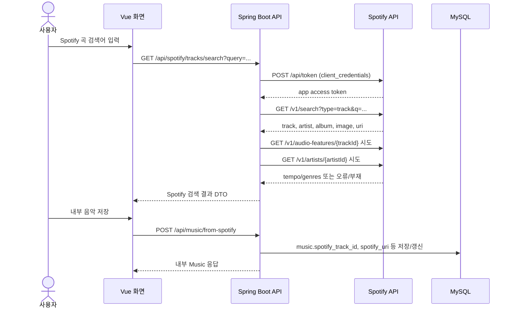
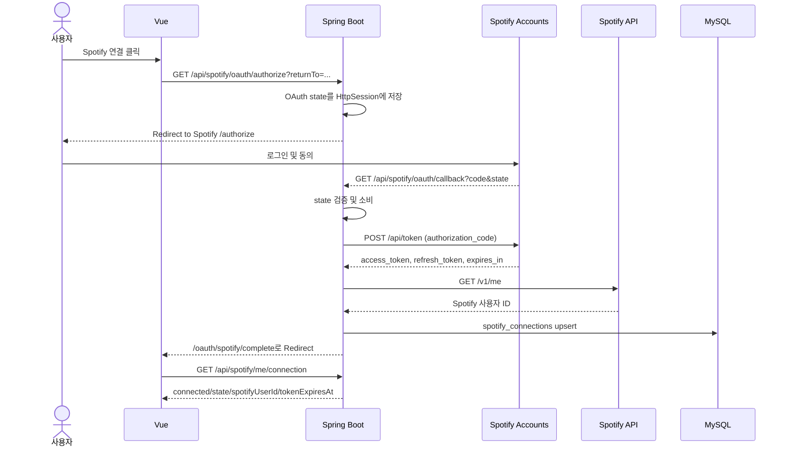

# SSAFIT PlayList 외부 API 활용 정리 문서

본 문서는 `docs/final/00-project-audit.md`, `docs/final/01-feature-evidence-matrix.md`와 실제 Spotify 연동 코드를 기준으로 작성한 제출용 외부 API 활용 정리이다. 코드 수정 없이 현재 저장소에 존재하는 구현만 근거로 삼았다.

## 1. 외부 API 선정 배경

### 1.1 음악 데이터 직접 구축 방식의 한계

러닝 음악 추천 서비스는 곡 제목, 아티스트, 앨범 이미지, 재생 시간, 외부 재생 링크, 플레이리스트 연동 식별자처럼 지속적으로 변하는 음악 메타데이터가 필요하다. 이 데이터를 팀이 직접 구축하면 다음 문제가 생긴다.

- 곡/앨범/아티스트 정보의 최신성 유지가 어렵다.
- 앨범 이미지와 외부 재생 링크를 자체적으로 수집, 검증, 갱신해야 한다.
- 사용자 Spotify 계정에 플레이리스트를 생성하는 경험은 내부 DB만으로 구현할 수 없다.
- 발표/시연 데이터와 실제 서비스 데이터가 분리되어 사용자 경험이 제한된다.

### 1.2 Spotify API 선택 이유

Spotify API는 트랙 검색, 트랙 기본 메타데이터, 앨범 이미지, 아티스트 정보, OAuth 기반 사용자 계정 연결, 사용자 계정 내 플레이리스트 생성 및 곡 추가 기능을 제공한다. 현재 프로젝트는 Spotify API를 통해 내부 음악 DB를 보강하고, SSAFIT PlayList에서 만든 플레이리스트를 사용자 Spotify 계정으로 내보내는 흐름을 구현했다.

- 근거 파일: `ssafit/src/main/java/com/ssafy/ssafit/spotify/client/SpotifyRestApiClient.java`
- 근거 클래스 또는 메서드: `SpotifyRestApiClient.searchTracks`, `createPlaylist`, `addTracks`, `exchangeAuthorizationCode`, `refreshAccessToken`
- 판단: 구현 완료
- 판단 사유: Spring `RestClient`로 Spotify Web API와 Accounts API에 실제 HTTP 요청을 보내는 코드가 존재한다.

### 1.3 사용자 경험 측면의 기대 효과

사용자는 SSAFIT 내부 음악 목록만 사용하는 대신 Spotify 검색 결과에서 곡을 찾아 내부 음악으로 저장할 수 있다. 또한 내부에서 구성한 플레이리스트를 Spotify 계정에 생성해 실제 청취 환경으로 이어갈 수 있다. 프론트엔드는 Spotify API를 직접 호출하지 않고 Spring Boot 백엔드 API만 호출하므로 Client Secret과 사용자 토큰이 브라우저 코드에 노출되지 않는다.

- 근거 파일: `frontend/src/api/spotifyApi.js`
- 근거 클래스 또는 메서드: `spotifyApi.searchTracks`, `spotifyApi.startAuthorization`, `spotifyApi.exportPlaylist`
- 판단: 구현 완료
- 판단 사유: Vue는 `/spotify/*`, `/playlists/{id}/export/spotify` 내부 API를 호출하며 Spotify API 직접 호출 코드는 없다.

## 2. Spotify API 활용 범위

| 활용 범위 | 현재 상태 | 근거 |
|---|---|---|
| 음악 검색 | 구현 완료 | `SpotifyRestApiClient.searchTracks`, `SpotifyService.searchTracks`, `GET /api/spotify/tracks/search` |
| 트랙 메타데이터 조회 | 구현 완료 | 검색 응답에서 `id`, `uri`, `external_urls.spotify`, `name`, `duration_ms`를 추출 |
| 아티스트, 앨범, 이미지 정보 활용 | 구현 완료 | 검색 응답의 첫 번째 artist, album name, album images 첫 번째 URL 사용 |
| Spotify OAuth 인증 | 구현 완료 | `SpotifyOAuthService.buildAuthorizationUrl`, `handleConnectCallback`, `handleLoginCallback` |
| 사용자 계정 연결 | 구현 완료 | `spotify_connections.member_id`, `spotify_user_id`, token 저장 |
| 사용자 Spotify 계정 내 플레이리스트 생성 | 구현 완료 | `SpotifyRestApiClient.createPlaylist`가 `/me/playlists` 호출 |
| 플레이리스트 트랙 추가 | 구현 완료 | `SpotifyRestApiClient.addTracks`가 `/playlists/{id}/items` 호출 |
| 사용자 Spotify 플레이리스트 목록 조회 | 구현 완료 | `SpotifyOAuthService.getCurrentUserPlaylists`, `/me/playlists` |
| Spotify 플레이리스트 가져오기 | 구현 완료 | `SpotifyPlaylistImportService.importPlaylist`, `getPlaylistTracks` |
| 내부 서비스 플레이리스트와 Spotify 플레이리스트 관계 저장 | 구현 완료 | `playlists.spotify_playlist_id`, `spotify_playlist_url`, `spotify_export_status` |
| BPM, 오디오 특성 기반 정밀 검색 | 외부 정책 또는 API 제한으로 대체 구현 | Search API는 키워드 기반이며, tempo 조회 실패 시 null 처리 |
| 장르 기반 정밀 매칭 | 부분 구현 | artist genre 조회를 시도하고 실패/부재 시 null 처리 |

## 3. 시스템 연동 구조

### 3.1 Vue -> Spring Boot -> Spotify API 흐름

### 3.2 OAuth Redirect 흐름

### 3.3 Access Token 및 Refresh Token 처리 구조

- OAuth callback에서 authorization code를 access token과 refresh token으로 교환한다.
- `spotify_connections` 테이블에 회원별 연결 정보를 저장한다.
- `getValidConnection`은 만료 30초 전 기준으로 access token 유효성을 확인한다.
- access token이 없거나 만료 임박이면 refresh token으로 갱신한다.
- Spotify API 작업 중 `SPOTIFY_AUTHORIZATION_FAILED`가 발생하면 `executeWithValidConnection`에서 한 번 refresh 후 재시도한다.
- refresh 응답에 새 refresh token이 없으면 기존 refresh token을 보존한다.

- 근거 파일: `ssafit/src/main/java/com/ssafy/ssafit/spotify/service/SpotifyOAuthService.java`
- 근거 클래스 또는 메서드: `getValidConnection`, `refreshConnection`, `executeWithValidConnection`, `saveConnection`
- 판단: 구현 완료
- 판단 사유: 토큰 만료 시각 확인, refresh token 갱신, 사용자별 연결 저장/갱신 로직이 구현되어 있다.

### 3.4 사용자별 Spotify 연결 정보 처리 방식

프로젝트 로그인 회원과 Spotify 계정은 `spotify_connections.member_id`로 1:1 연결된다. 같은 Spotify 사용자 ID가 다른 회원에게 이미 연결되어 있으면 연결 실패로 처리한다. Spotify 로그인 전용 흐름에서는 기존 Spotify 연결이 있으면 해당 회원으로 로그인하고, 없으면 `spotify_{hash}` 형태의 내부 회원을 생성한다.

- 근거 파일: `ssafit/src/main/java/com/ssafy/ssafit/spotify/service/SpotifyOAuthService.java`
- 근거 클래스 또는 메서드: `handleConnectCallback`, `handleLoginCallback`, `findExistingSpotifyConnection`, `createSpotifyMember`
- 판단: 구현 완료
- 판단 사유: 프로젝트 세션 회원과 Spotify 사용자 ID의 중복 연결을 검증하고, Spotify 로그인 흐름까지 분리되어 있다.

### 3.5 DB 저장 항목

실제 스키마에서 확인된 Spotify 관련 컬럼은 다음과 같다.

| 테이블 | 컬럼 | 용도 | 근거 |
|---|---|---|---|
| `music` | `spotify_track_id` | Spotify Track ID, 중복 저장 방지 | `schema.sql`, `MusicMapper.xml` |
| `music` | `spotify_uri` | Spotify track URI, 플레이리스트 export 수록곡 추가에 사용 | `schema.sql`, `PlaylistItemMapper.selectExportTracks` |
| `music` | `spotify_external_url` | Spotify 웹 URL 표시 | `schema.sql`, `MusicApiDtos.MusicResponse` |
| `playlists` | `spotify_playlist_id` | export 결과 Spotify Playlist ID | `schema.sql`, `PlaylistMapper.updateSpotifyExportResult` |
| `playlists` | `spotify_playlist_url` | export 결과 Spotify Playlist URL | `schema.sql`, `PlaylistMapper.updateSpotifyExportResult` |
| `playlists` | `spotify_export_status` | `NOT_EXPORTED`, `PENDING`, `SUCCESS`, `PARTIAL`, `FAILED` 상태 저장 | `schema.sql`, `SpotifyExportStatus` |
| `playlists` | `spotify_export_error_code` | export 실패/부분 성공 오류 코드 | `schema.sql`, `PlaylistMapper.updateSpotifyExportFailure` |
| `playlists` | `spotify_exported_at` | 성공/부분 성공 시각 | `schema.sql`, `PlaylistMapper.updateSpotifyExportResult` |
| `spotify_connections` | `spotify_user_id` | 연결된 Spotify 사용자 ID | `schema.sql`, `SpotifyConnectionMapper.xml` |
| `spotify_connections` | `access_token` | Spotify Access Token | `schema.sql`, `SpotifyOAuthService.saveConnection` |
| `spotify_connections` | `refresh_token` | Spotify Refresh Token | `schema.sql`, `SpotifyOAuthService.refreshConnection` |
| `spotify_connections` | `token_expires_at` | 토큰 만료 시각 | `schema.sql`, `SpotifyOAuthService.getValidConnection` |

민감 정보인 `access_token`, `refresh_token`, Client Secret 값은 문서에 노출하지 않는다. 현재 코드 기준 DB 컬럼은 존재하지만 애플리케이션 계층 암호화 코드는 확인되지 않는다.

## 4. API별 요청 및 응답 데이터 정리

| 기능 | Spotify API 또는 Endpoint | 요청 방식 | 주요 요청 데이터 | 주요 응답 데이터 | 내부 활용 방식 | 관련 코드 |
|---|---|---|---|---|---|---|
| Client Credentials 토큰 발급 | `POST https://accounts.spotify.com/api/token` | `application/x-www-form-urlencoded`, Basic Auth | `grant_type=client_credentials` | `access_token` | 검색용 앱 access token 발급 | `SpotifyRestApiClient.issueClientAccessToken`, `postToken` |
| 음악 검색 | `GET https://api.spotify.com/v1/search` | Bearer token | `q`, `type=track`, `offset`, `limit` | track `id`, `uri`, `external_urls`, `name`, `artists`, `album`, `images`, `duration_ms` | 검색 결과 표시 및 내부 음악 저장 후보 생성 | `SpotifyRestApiClient.searchTracks`, `SpotifyService.searchTracks` |
| 트랙 tempo 조회 시도 | `GET https://api.spotify.com/v1/audio-features/{trackId}` | Bearer token | `trackId` | `tempo` | 가능한 경우 `musicBpm`으로 보강, 실패 시 null | `SpotifyRestApiClient.getTrackTempoBpm`, `SpotifyService.resolveTempoBpm` |
| 아티스트 장르 조회 시도 | `GET https://api.spotify.com/v1/artists/{artistId}` | Bearer token | `artistId` | `genres` | 가능한 경우 첫 번째 장르를 `genre`로 보강, 실패 시 null | `SpotifyRestApiClient.getArtistGenres`, `SpotifyService.resolveGenre` |
| OAuth 인증 URL 생성 | `GET https://accounts.spotify.com/authorize` | Browser redirect | `client_id`, `response_type=code`, `redirect_uri`, `scope`, `state` | authorization code redirect | 사용자 Spotify 연결 또는 Spotify 로그인 시작 | `SpotifyOAuthService.buildAuthorizationUrl`, `SpotifyApiController.authorize` |
| Authorization Code 교환 | `POST https://accounts.spotify.com/api/token` | `application/x-www-form-urlencoded`, Basic Auth | `grant_type=authorization_code`, `code`, `redirect_uri` | `access_token`, `refresh_token`, `expires_in` | 사용자별 Spotify 연결 정보 저장 | `SpotifyRestApiClient.exchangeAuthorizationCode`, `SpotifyOAuthService.handleConnectCallback` |
| Access Token 갱신 | `POST https://accounts.spotify.com/api/token` | `application/x-www-form-urlencoded`, Basic Auth | `grant_type=refresh_token`, `refresh_token` | 새 `access_token`, 선택적 `refresh_token`, `expires_in` | 만료/오류 시 사용자 토큰 갱신 | `SpotifyRestApiClient.refreshAccessToken`, `SpotifyOAuthService.refreshConnection` |
| 현재 사용자 조회 | `GET https://api.spotify.com/v1/me` | Bearer token | user access token | Spotify user `id`, `display_name` | `spotify_connections.spotify_user_id` 저장, Spotify 로그인 회원 연결 | `SpotifyRestApiClient.getCurrentUser`, `SpotifyOAuthService.exchangeAndResolveIdentity` |
| 내 Spotify 플레이리스트 목록 조회 | `GET https://api.spotify.com/v1/me/playlists` | Bearer token | `offset`, `limit` | playlist `id`, `name`, `external_urls`, `owner`, `public`, `tracks.total` | Spotify playlist import 후보 표시 | `SpotifyRestApiClient.getCurrentUserPlaylists`, `SpotifyApiController.getCurrentUserPlaylists` |
| Spotify 플레이리스트 트랙 조회 | `GET https://api.spotify.com/v1/playlists/{id}/tracks` | Bearer token | `playlistId`, `offset`, `limit`, `fields` | track `id`, `uri`, `external_urls`, `name`, `artists`, `album`, `images`, `duration_ms` | Spotify 플레이리스트를 내부 playlist/music으로 import | `SpotifyRestApiClient.getPlaylistTracks`, `SpotifyPlaylistImportService.importTracks` |
| Spotify 플레이리스트 생성 | `POST https://api.spotify.com/v1/me/playlists` | JSON, Bearer token | `name`, `description`, `public` | playlist `id`, `external_urls.spotify` | 내부 playlist export 대상 생성 | `SpotifyRestApiClient.createPlaylist`, `PlaylistExportService.exportWithResult` |
| Spotify 플레이리스트 트랙 추가 | `POST https://api.spotify.com/v1/playlists/{id}/items` | JSON, Bearer token | `uris` | 응답 본문 미사용 | 내부 playlist 수록곡의 `spotify_uri`를 Spotify playlist에 추가 | `SpotifyRestApiClient.addTracks`, `PlaylistExportService.exportChunks` |

## 5. 외부 API 활용 시 발생한 제약

### 5.1 Spotify 정책 또는 권한 제한

Spotify 연동은 Client ID, Client Secret, Redirect URI, scope, 개발자 대시보드 설정에 의존한다. README와 `.env.example`은 실제 값이 `.env` 또는 실행 환경에만 들어가야 한다고 안내한다. 실제 Spotify OAuth 및 export 시연은 발표 계정이 Spotify Developer Dashboard의 User Management에 등록되어 있어야 한다.

- 근거 파일: `.env.example`, `README.md`, `docs/cadence-intensity-spotify-demo-script.md`
- 판단: 외부 정책 또는 API 제한으로 대체 구현
- 판단 사유: 코드 구현은 존재하지만 실제 API 사용은 개발자 앱 설정, redirect URI, 허용 사용자 등록에 좌우된다.

### 5.2 BPM 정보 제공 제한 여부

현재 코드는 `/audio-features/{trackId}`의 `tempo`를 조회하는 메서드를 구현했지만, 실패하면 `SpotifyService.resolveTempoBpm`에서 warn 로그 후 null을 반환한다. 별도 `MusicTempoProvider`는 기본 구현이 `NoOpMusicTempoProvider`이며, `.env.example`의 `SPOTIFY_AUDIO_FEATURE_ENRICHMENT_ENABLED=false`가 기본값이다.

- 근거 파일: `ssafit/src/main/java/com/ssafy/ssafit/spotify/service/SpotifyService.java`
- 근거 클래스 또는 메서드: `resolveTempoBpm`
- 판단: 외부 정책 또는 API 제한으로 대체 구현
- 판단 사유: tempo 조회 실패를 서비스 실패로 보지 않고 null 메타데이터로 처리한다.

### 5.3 오디오 특성 데이터 제공 제한 여부

오디오 특성 중 현재 실제로 읽는 필드는 `tempo`뿐이다. energy, danceability 등 다른 audio feature 필드를 DTO나 DB에 저장하는 구현은 확인되지 않았다. `music_energy_level`은 Spotify 원본 energy 값이 아니라 내부 등록/추천용 체감 에너지 레벨이다.

- 근거 파일: `ssafit/src/main/java/com/ssafy/ssafit/spotify/client/SpotifyRestApiClient.java`
- 근거 클래스 또는 메서드: `getTrackTempoBpm`
- 판단: 부분 구현
- 판단 사유: `/audio-features/{id}` 호출 코드는 있으나 tempo 외의 오디오 특성 저장/활용은 구현되어 있지 않다.

### 5.4 장르 정보의 정확성 또는 활용 제약

Spotify 검색 응답의 track 자체에는 프로젝트가 바로 쓰는 단일 장르가 없다. 현재 코드는 첫 번째 아티스트 ID로 `/artists/{id}`를 조회하고 genres 배열의 첫 번째 값을 내부 `genre`로 사용한다. 실패하거나 장르 배열이 비어 있으면 null로 저장한다.

- 근거 파일: `ssafit/src/main/java/com/ssafy/ssafit/spotify/service/SpotifyService.java`
- 근거 클래스 또는 메서드: `resolveGenre`
- 판단: 부분 구현
- 판단 사유: 아티스트 단위 장르를 첫 번째 값만 사용하므로 곡 단위 장르와 동일하다고 표현하면 안 된다.

### 5.5 개발자 계정 및 User Management 제한

기존 검증 문서에는 실제 Spotify OAuth 동의, callback, 연결 상태, 실제 플레이리스트 생성은 자격 증명과 User Management 설정에 의존한다고 정리되어 있다. 개발 모드에서는 등록되지 않은 Spotify 계정이 OAuth에서 거부될 수 있다.

- 근거 파일: `docs/cadence-intensity-spotify-verification-report.md`
- 판단: 테스트 필요
- 판단 사유: 자동 테스트는 mock 중심이며 실제 Spotify 계정 기반 수동 시연은 환경 설정이 필요하다.

### 5.6 사용자별 OAuth 연결 제약

동일한 Spotify 사용자 ID가 다른 SSAFIT 회원에게 이미 연결되어 있으면 연결 실패로 처리한다. 이는 내 계정과 다른 사용자 계정에서 같은 Spotify 계정으로 플레이리스트를 생성하는 문제를 방지한다. 반대로 발표 시 로그인한 SSAFIT 회원과 연결된 Spotify 계정이 실제 플레이리스트가 생성될 계정이므로, 다른 Spotify 계정에서 결과를 찾으면 생성되지 않은 것처럼 보일 수 있다.

- 근거 파일: `ssafit/src/main/java/com/ssafy/ssafit/spotify/service/SpotifyOAuthService.java`
- 근거 클래스 또는 메서드: `findExistingSpotifyConnection`, `handleConnectCallback`
- 판단: 구현 완료
- 판단 사유: Spotify 사용자 ID의 중복 연결을 막고 회원별 토큰으로 export를 수행한다.

### 5.7 내 계정과 다른 사용자 계정에서 플레이리스트 생성 시 발생한 문제

코드상 playlist export는 현재 SSAFIT 로그인 회원의 `spotify_connections` 토큰으로 수행된다. 따라서 Spotify 플레이리스트는 “현재 SSAFIT 회원에게 연결된 Spotify 계정”에 생성된다. 팀원 또는 발표자가 다른 Spotify 계정으로 Spotify 앱을 확인하면 생성 결과가 보이지 않을 수 있다. 이 문제는 구현 실패라기보다 OAuth 계정 연결과 시연 계정 불일치 문제다.

- 근거 파일: `ssafit/src/main/java/com/ssafy/ssafit/spotify/service/PlaylistExportService.java`
- 근거 클래스 또는 메서드: `exportWithResult`
- 판단: 테스트 필요
- 판단 사유: `spotifyOAuthService.executeWithValidConnection(loginMemberId, ...)`로 로그인 회원의 토큰을 사용한다.

### 5.8 Rate Limit 또는 네트워크 오류 처리 여부

`SpotifyRestApiClient.spotifyApiException`은 HTTP 429를 `SPOTIFY_RATE_LIMITED`, 403을 `SPOTIFY_FORBIDDEN`, 400/401을 `SPOTIFY_AUTHORIZATION_FAILED`, 그 외를 `SPOTIFY_API_FAILED`로 분류한다. 다만 `Retry-After`를 읽어 자동 대기/재시도하는 구현은 확인되지 않았다.

- 근거 파일: `ssafit/src/main/java/com/ssafy/ssafit/spotify/client/SpotifyRestApiClient.java`
- 근거 클래스 또는 메서드: `spotifyApiException`, `logSpotifyApiFailure`
- 판단: 부분 구현
- 판단 사유: 오류 분류와 로그 마스킹은 구현되어 있으나 rate limit backoff 재시도 정책은 없다.

## 6. 제약에 대한 대응 전략

| 대응 전략 | 상태 | 실제 구현 또는 설계 내용 | 근거 |
|---|---|---|---|
| BPM 직접 활용 대신 BPM 범위 기반 추천 | 구현 완료 | 러닝 강도 또는 프로필 기반으로 음악 BPM 범위를 정하고 후보를 점수화한다. | `MusicService.bpmRangeFor`, `RecommendationService.resolveBpmRange` |
| 사용자의 탭 템포 기반 BPM 추정 | 향후 개선 | 저장소에서 탭 템포 입력/추정 UI 또는 API는 확인되지 않았다. | 구현 파일 없음 |
| 사용자의 체감 운동 강도 선택 | 구현 완료 | `RunningIntensity`, `RunningIntensityGoal`을 추천 입력으로 사용한다. | `RecommendationApiController`, `RecommendationService.recommend` |
| Mock 또는 더미 음악 데이터 활용 | 구현 완료 | Docker 초기 데이터로 `demo-snapshot.sql`을 사용하고, 실제 Spotify 자격 증명 없이도 내부 기능 시연이 가능하다. | `compose.yaml`, `schema.sql`, `demo-snapshot.sql` |
| Spotify 메타데이터 중심 검색 | 구현 완료 | 제목, 아티스트, 앨범, 이미지, duration, URI, external URL 중심으로 검색 결과를 제공한다. | `SpotifyRestApiClient.searchTracks`, `SpotifyApiDtos.TrackResponse` |
| 내부 DB 기반 추천과 Spotify 검색 결과의 결합 | 구현 완료 | 로컬 후보가 없거나 장르 검색이 필요한 경우 Spotify 후보를 import한 뒤 내부 추천 점수화에 포함한다. | `RecommendationService.importSpotifyCandidates`, `scoreMusic` |
| 데이터 부재 시 특정 점수를 0점 처리하지 않고 가중치 제외 | 구현 완료 | cadence/intensity/preference 점수 중 null인 항목은 분자와 분모에서 제외하고 사용 가능한 가중치만으로 재정규화한다. | `RecommendationService.weightedScore` |
| Spotify tempo 조회 실패 시 null 처리 | 구현 완료 | tempo 조회 예외를 전체 검색 실패로 처리하지 않고 null로 보강 실패 처리한다. | `SpotifyService.resolveTempoBpm` |
| Spotify 장르 조회 실패 시 null 처리 | 구현 완료 | artist genres 조회 예외를 전체 검색 실패로 처리하지 않고 null로 보강 실패 처리한다. | `SpotifyService.resolveGenre` |
| Spotify URI 없는 수록곡 export 제외 | 구현 완료 | export 대상에서 `spotifyTrackId`와 `spotifyUri`가 없는 곡을 skipped로 분류한다. | `PlaylistExportService.exportWithResult`, `PlaylistExportTrack.exportable` |
| Rate Limit 자동 재시도/backoff | 향후 개선 | 429 오류 분류는 있으나 `Retry-After` 기반 자동 재시도는 확인되지 않았다. | `SpotifyRestApiClient.spotifyApiException` |
| 토큰 암호화 저장 | 향후 개선 | access/refresh token 컬럼은 있으나 암호화 저장 구현은 확인되지 않았다. | `SpotifyConnectionMapper.xml`, `schema.sql` |

## 7. 테스트 및 시연 방법

### 7.1 자동 테스트 근거

Spotify 관련 자동 테스트는 실제 Spotify API를 직접 호출하기보다 mock/fake client를 사용해 서비스 로직과 컨트롤러 흐름을 검증하는 성격이다.

| 검증 대상 | 테스트/문서 근거 | 설명 |
|---|---|---|
| Spotify 검색 및 저장 로직 | `ssafit/src/test/java/com/ssafy/ssafit/spotify/service/SpotifyServiceTest.java` | 검색 결과 변환, 메타데이터 저장 흐름 검증 |
| OAuth 연결 상태 및 callback | `ssafit/src/test/java/com/ssafy/ssafit/spotify/controller/api/SpotifyApiControllerTest.java`, `SpotifyOAuthServiceTest.java` | state, 연결 상태, callback redirect 검증 |
| Playlist export | `ssafit/src/test/java/com/ssafy/ssafit/spotify/service/PlaylistExportServiceTest.java` | Spotify URI 누락 skip, chunk 처리, 상태 저장 검증 |
| Mapper 통합 | `docs/verification/mysql-mapper-integration-test-report.md` | Spotify Mapper 포함 MySQL 통합 테스트 통과 기록 |
| 환경 테스트 | 사용자 확인 기준 통과 전제 | Maven/환경 테스트는 STS 및 Docker 환경에서 통과한 것으로 반영 |

### 7.2 실제 Spotify 시연 사전 조건

1. `.env` 또는 실행 환경에 `SPOTIFY_CLIENT_ID`, `SPOTIFY_CLIENT_SECRET`, `SPOTIFY_REDIRECT_URI`를 설정한다.
2. Spotify Developer Dashboard의 Redirect URI와 `SPOTIFY_REDIRECT_URI`를 문자 단위로 일치시킨다.
3. 개발 모드라면 발표용 Spotify 계정을 User Management에 등록한다.
4. Docker 기준 `SPOTIFY_REDIRECT_URI=http://127.0.0.1:5173/api/spotify/oauth/callback` 구성을 사용한다.
5. 브라우저에서 로그인한 SSAFIT 회원과 실제 확인할 Spotify 계정이 같은 연결인지 확인한다.

### 7.3 시연 절차

1. `/music`에서 Spotify 검색어를 입력한다.
2. 검색 결과의 제목, 아티스트, 앨범 이미지, duration, 저장 버튼을 확인한다.
3. 검색 결과를 내부 음악으로 저장한다.
4. `/playlists/new`에서 내부 플레이리스트를 만든다.
5. `/playlists/{playlistId}`에서 Spotify 곡을 검색해 수록곡으로 추가한다.
6. Spotify 연결 버튼을 눌러 OAuth를 완료한다.
7. 같은 플레이리스트 화면에서 Spotify 내보내기를 실행한다.
8. 화면의 export 상태, 성공 곡 수, skipped 곡 수, Spotify URL을 확인한다.
9. 실제 Spotify 앱 또는 웹에서 생성된 플레이리스트를 확인한다.
10. DB에서는 `playlists.spotify_playlist_id`, `spotify_playlist_url`, `spotify_export_status`, `spotify_exported_at` 저장을 확인한다.

## 8. 발표 및 보고서용 캡처 가이드

### 캡처 1. Spotify 검색 결과 화면

- 목적: 외부 API 기반 음악 검색 기능 증빙
- 화면 경로: `/music` 또는 `/playlists/{playlistId}`
- 사전 조건: `SPOTIFY_CLIENT_ID`, `SPOTIFY_CLIENT_SECRET` 설정
- 반드시 보여야 하는 요소:
  - 검색어
  - Spotify 검색 결과
  - 곡 제목, 아티스트, 앨범 이미지
  - 내부 음악 저장 또는 플레이리스트 추가 버튼
- 연결 코드:
  - Frontend: `frontend/src/views/MusicListView.vue`, `frontend/src/views/PlaylistDetailView.vue`, `frontend/src/api/spotifyApi.js`
  - Backend: `SpotifyApiController.searchTracks`, `SpotifyService.searchTracks`, `SpotifyRestApiClient.searchTracks`
- 유의 사항:
  - BPM/장르는 Spotify 조회 실패 또는 정책 제한으로 비어 있을 수 있다.

### 캡처 2. Spotify OAuth 연결 완료 화면

- 목적: 사용자별 Spotify 계정 연결 증빙
- 화면 경로: `/oauth/spotify/complete`
- 사전 조건: Spotify Dashboard Redirect URI 등록, 발표 계정 User Management 등록
- 반드시 보여야 하는 요소:
  - 연결 완료 또는 재연결 필요 상태
  - 연결된 Spotify 사용자 ID
  - 이전 화면으로 돌아가기 경로
- 연결 코드:
  - Frontend: `SpotifyOAuthCompleteView.vue`, `spotifyApi.getConnection`
  - Backend: `SpotifyApiController.authorize/callback/getConnection`, `SpotifyOAuthService`
- 유의 사항:
  - Client Secret, access token, refresh token은 화면과 문서에 노출하지 않는다.

### 캡처 3. Spotify 플레이리스트 내보내기 화면

- 목적: 내부 플레이리스트를 Spotify 계정으로 생성하는 기능 증빙
- 화면 경로: `/playlists/{playlistId}` 또는 추천 결과 저장 플레이리스트
- 사전 조건: Spotify OAuth 연결, 수록곡에 `spotify_uri` 존재
- 반드시 보여야 하는 요소:
  - export 버튼
  - 요청 곡 수
  - 성공 곡 수
  - skipped 곡 수
  - Spotify playlist URL
  - `SUCCESS` 또는 `PARTIAL` 상태
- 연결 코드:
  - Frontend: `SpotifyExportPanel.vue`, `PlaylistDetailView.vue`, `playlistApi.exportToSpotify`, `spotifyApi.exportPlaylist`
  - Backend: `PlaylistExportApiController.export`, `PlaylistExportService.exportWithResult`, `SpotifyRestApiClient.createPlaylist`, `SpotifyRestApiClient.addTracks`
- 유의 사항:
  - Spotify URI가 없는 내부 등록 곡은 내보내기에서 제외될 수 있다.

### 캡처 4. DB 저장 결과

- 목적: 외부 API 결과가 내부 DB와 연결되는 구조 증빙
- 확인 대상:
  - `music.spotify_track_id`
  - `music.spotify_uri`
  - `music.spotify_external_url`
  - `playlists.spotify_playlist_id`
  - `playlists.spotify_playlist_url`
  - `playlists.spotify_export_status`
  - `spotify_connections.spotify_user_id`
- 유의 사항:
  - `access_token`, `refresh_token` 값은 캡처하지 않거나 반드시 가린다.

### 캡처 5. Spotify 앱 또는 웹의 생성된 플레이리스트

- 목적: 외부 서비스에 실제 결과가 생성되었음을 증빙
- 사전 조건: export를 수행한 계정과 확인 중인 Spotify 계정이 동일해야 한다.
- 반드시 보여야 하는 요소:
  - 플레이리스트 이름
  - 수록곡 목록
  - 공개/비공개 상태가 내부 playlist visibility와 맞는지
- 유의 사항:
  - 다른 Spotify 계정으로 확인하면 생성 결과가 보이지 않을 수 있다.

## 9. 외부 API 활용 성과

1. Spotify 검색 API를 통해 내부 seed 데이터만으로는 부족한 실제 음악 메타데이터를 검색하고 저장할 수 있게 했다.
2. 앨범 이미지, 아티스트, 앨범명, Spotify URI, 외부 URL을 내부 음악 도메인과 연결했다.
3. OAuth 기반 사용자별 Spotify 계정 연결을 구현해 개인 계정 내 playlist 생성이 가능해졌다.
4. 내부 playlist와 Spotify playlist의 관계를 DB에 저장해 export 상태를 추적할 수 있게 했다.
5. 외부 API 실패와 정책 제한을 고려해 tempo/genre 보강 실패를 null로 처리하고, 추천 점수에서는 누락 데이터를 가중치에서 제외하는 방식을 적용했다.
6. Vue가 Spotify API를 직접 호출하지 않고 Spring Boot를 통해서만 연동하도록 구성해 Client Secret과 사용자 토큰의 브라우저 노출을 피했다.
7. export 실패, 부분 성공, 이미 export된 상태를 `spotify_export_status`와 오류 코드로 분리해 발표와 디버깅에 필요한 상태 정보를 확보했다.

## 10. 한계 및 향후 개선 방향

### 10.1 현재 한계

- Spotify Search API는 BPM, 장르, 오디오 특성 조건 검색 API가 아니므로 “BPM 기반 Spotify 정밀 검색”이라고 표현하면 안 된다.
- `/audio-features/{id}` tempo 조회 코드는 있으나 정책/권한/API 실패 시 null 처리되며, energy 등 다른 오디오 특성은 저장하지 않는다.
- 장르는 곡 단위 장르가 아니라 아티스트 genres의 첫 번째 값을 선택적으로 사용한다.
- 실제 OAuth와 export 시연은 Spotify 개발자 앱 설정, Redirect URI, User Management 등록 상태에 의존한다.
- access token과 refresh token은 DB 컬럼에 저장되지만 현재 코드에서 암호화 저장 구현은 확인되지 않는다.
- 429 Rate Limit은 오류 코드로 분류하지만 `Retry-After` 기반 자동 대기/재시도는 구현되어 있지 않다.
- 외부 Spotify 작업과 내부 DB 상태 저장은 하나의 원자적 트랜잭션으로 묶을 수 없으므로 부분 성공 상태가 발생할 수 있다.
- Spotify URI가 없는 내부 음악은 export에서 skipped 처리될 수 있다.

### 10.2 향후 개선 방향

- Spotify 정책상 허용되는 범위 내에서 tempo/audio feature 제공 가능 여부를 재검토하고, 불가능한 경우 수동 BPM 입력 또는 탭 템포 추정 UI를 추가한다.
- 사용자 체감 운동 강도와 내부 `music_energy_level` 입력 흐름을 더 명확히 만들어 Spotify energy 부재를 보완한다.
- Spotify token 암호화 저장 또는 Secret Manager/KMS 연계를 검토한다.
- 429 Rate Limit의 `Retry-After` 처리와 네트워크 오류 재시도 정책을 추가한다.
- export 부분 성공 상태에서 안전하게 재시도할 수 있는 정책을 설계한다.
- Spotify playlist 외부 삭제/권한 변경을 감지하는 동기화 또는 상태 재검증 API를 추가한다.
- 발표/운영 환경별 Redirect URI와 Frontend origin 설정을 문서화하고 자동 점검 스크립트를 추가한다.

## 11. 최종 보고서 표현 주의 사항

- “Spotify가 BPM 기반으로 곡을 검색한다”가 아니라 “Spotify 검색 결과를 가져온 뒤 가능한 경우 tempo/genre를 보강하고 내부 추천 점수에 활용한다”라고 표현한다.
- “모든 Spotify 곡이 추천에 활용된다”가 아니라 “BPM/energy/genre가 없으면 해당 점수는 제외되거나 제한된다”라고 표현한다.
- “실제 Spotify API 자동 테스트 완료”가 아니라 “자동 테스트는 mock 중심이며 실제 API는 자격 증명과 계정 설정 후 수동 시연이 필요하다”라고 표현한다.
- “Spotify playlist export는 항상 전체 성공한다”가 아니라 “URI가 있는 곡을 대상으로 export하며 실패/부분 성공/skipped 상태를 구분한다”라고 표현한다.
- “토큰 보안이 완비되었다”가 아니라 “브라우저 노출은 피했지만 DB 저장 토큰 암호화는 향후 개선 사항”이라고 표현한다.
