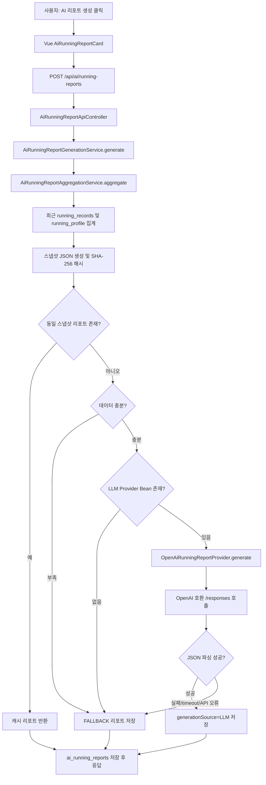

# SSAFIT PlayList 생성형 AI 활용 정리

## 1. AI 활용 목표

SSAFIT PlayList의 생성형 AI 활용 목표는 사용자의 러닝 기록, 케이던스, 심박, 운동 강도 관련 데이터를 사람이 직접 해석해야 하는 부담을 줄이고, 자연어 리포트 또는 운동 계획 형태로 다음 행동을 제안하는 것이다.

현재 코드 기준으로 서비스 기능 안에 구현된 AI 활용은 두 갈래다.

| 판정 항목 | 실제 상태 | 근거 |
| --- | --- | --- |
| LLM API 실제 호출 구현 여부 | 구현 완료. 단, 기본 실행값은 비활성 | `OpenAiRunningReportProvider.generate`, `AI_RUNNING_REPORT_ENABLED=false`, `AI_RUNNING_REPORT_PROVIDER=none` |
| 생성형 AI 기반 러닝 리포트/데이터 요약 | 구현 완료 | `AiRunningReportApiController`, `AiRunningReportGenerationService`, `AiRunningReportCard.vue` |
| 프롬프트 템플릿 존재 여부 | 코드 내 텍스트 블록으로 존재 | `AiRunningReportGenerationService.SYSTEM_PROMPT`, `RecommendationService.WORKOUT_PLAN_SYSTEM_PROMPT` |
| AI 응답 저장 여부 | 구현 완료 | `ai_running_reports`, `AiRunningReportMapper.xml`, `AiRunningReportStorageService` |
| Mock AI 응답 또는 더미 데이터 사용 여부 | 테스트는 Fake Provider 사용. 운영 기본은 Mock이 아니라 서버 계산 fallback | `AiRunningReportGenerationServiceTest`, `saveFallback` |
| 외부 LLM API Key 환경 변수 존재 여부 | 존재. 실제 값은 저장소에 없음 | `.env.example`, `compose.yaml`, `application.yml` |
| AI 기능이 화면에서 호출 가능한지 여부 | 호출 가능 | `RunningRecordListView.vue`, `AiRunningReportCard.vue`, `aiRunningReportApi.js` |
| AI 기능이 단순 계획 단계인지 여부 | 러닝 리포트는 계획 단계가 아니라 구현됨. 목표 거리 기반 운동 계획은 부분 구현 | `RecommendationService.generateWorkoutPlan` |

- 근거 파일: `ssafit/src/main/java/com/ssafy/ssafit/airunningreport/provider/OpenAiRunningReportProvider.java`
- 근거 클래스 또는 메서드: `OpenAiRunningReportProvider.generate`
- 판단: 구현 완료
- 판단 사유: OpenAI 호환 Responses API `/responses`로 `model`, `input`, `temperature`, `max_output_tokens`를 포함한 HTTP POST를 수행한다. 다만 `ai.running-report.enabled=true`, `provider=openai`, API Key 설정이 있어야 Bean이 활성화된다.

- 근거 파일: `ssafit/src/main/java/com/ssafy/ssafit/airunningreport/service/AiRunningReportGenerationService.java`
- 근거 클래스 또는 메서드: `generateLocked`, `saveFallback`
- 판단: 구현 완료
- 판단 사유: 집계 데이터 생성, 스냅샷 해시, 캐시 재사용, LLM Provider 호출, JSON 파싱, fallback 저장까지 구현되어 있다.

## 2. 해결하려는 사용자 문제

러닝 기록은 거리, 시간, 페이스, 케이던스, 심박처럼 숫자 중심으로 저장된다. 숫자만으로는 사용자가 자신의 러닝 패턴이 안정적인지, 다음 러닝 목표를 어떻게 잡아야 하는지, 데이터가 충분한지 판단하기 어렵다.

AI 러닝 리포트는 이 문제를 다음 방식으로 해결한다.

| 사용자 문제 | AI 적용 방식 | 현재 구현 상태 |
| --- | --- | --- |
| 숫자 중심 러닝 기록을 직접 해석해야 함 | 최근 러닝 기록 집계를 자연어 요약으로 변환 | 구현 완료 |
| 케이던스/심박 데이터가 일부 없을 때 의미를 오해할 수 있음 | 데이터 부족 항목을 `missingItems`, `dataLimitations`로 명시 | 구현 완료 |
| 다음 운동 목표를 스스로 정하기 어려움 | 최근 평균 흐름을 벗어나지 않는 다음 러닝 방향 제안 | 구현 완료 |
| 목표 거리 기반 운동 계획이 필요함 | 목표 거리 입력 시 운동 시간, 페이스, 케이던스, 심박, 음악 BPM 전략 제안 | 부분 구현 |
| 음악 추천 결과와 러닝 리포트의 연결 설명이 필요함 | 현재 AI 리포트 입력에는 추천 로그/플레이리스트 이력이 포함되지 않음 | 향후 개선 |

## 3. AI 적용 기능 개요

| 기능 | 사용자 진입점 | 백엔드 API | 핵심 구현 | LLM 호출 | fallback | 상태 |
| --- | --- | --- | --- | --- | --- | --- |
| AI 러닝 리포트 | 러닝 기록 목록의 `AiRunningReportCard` | `POST /api/ai/running-reports`, `GET /api/ai/running-reports/latest` | 최근 러닝 기록 집계 후 자연어 리포트 저장 | 환경 설정 시 OpenAI 호환 API 호출 | 있음 | 구현 완료 |
| 목표 거리 기반 운동 계획 | `/recommendations` 목표 거리 입력 흐름 | `GET /api/recommendations` | 목표 거리, 러닝 프로필, 피트니스 점수 기반 운동 계획 생성 | Provider가 있으면 호출 | 있음 | 부분 구현 |
| 개발 과정에서의 AI 활용 | 코드상 서비스 기능 아님 | 해당 없음 | 제출 문서 또는 개발 보조 사실은 별도 설명 필요 | 코드 근거 없음 | 해당 없음 | 문서화 시 분리 필요 |
| 향후 AI 확장 | 추천 로그, 저장 플레이리스트, Spotify export 결과 요약 | 미구현 | DTO 일부는 존재하나 현재 Aggregation에는 포함되지 않음 | 미구현 | 미구현 | 향후 개선 |

중요한 경계는 다음과 같다. `AiRunningReportAggregationDtos`에는 `RecommendationSummary`, `SavedPlaylistSummary` 타입이 존재하지만, 현재 `Aggregation` record와 `AiRunningReportAggregationService.aggregate` 결과에는 이 필드들이 포함되지 않는다. 따라서 최종 보고서에서 "AI 리포트가 음악 추천 이력과 저장 플레이리스트 이력을 함께 분석한다"라고 표현하면 안 된다.

## 4. 입력 데이터 구조

AI 러닝 리포트의 실제 입력은 `AiRunningReportAggregationService`가 생성한 `Aggregation` 객체를 JSON으로 직렬화한 스냅샷이다. 회원 ID, 이메일, 닉네임은 프롬프트 입력에 포함되지 않도록 테스트에서 검증된다.

| 데이터 범주 | 입력 필드 | 출처 테이블 또는 DTO | AI 활용 목적 | 구현 상태 |
| --- | --- | --- | --- | --- |
| 분석 기간 | `analysisStartDate`, `analysisEndDate` | `running_records`, `Aggregation` | 리포트 기준 기간 표시 | 구현 완료 |
| 기록 개수 | `requestedRecordLimit`, `runningRecordCount` | `Aggregation` | 데이터 충분성 판단 | 구현 완료 |
| 러닝 거리 | `totalDistanceKm`, `averageDistanceKm` | `RunningMetricSummary` | 최근 러닝 양 요약 | 구현 완료 |
| 러닝 시간 | `totalDurationSeconds`, `averageDurationSeconds` | `RunningMetricSummary` | 운동 지속 시간 요약 | 구현 완료 |
| 페이스 | `averagePaceSecondsPerKm` | `running_records.pace_seconds_per_km`, `RunningMetricSummary` | 페이스 흐름 설명 | 구현 완료 |
| 케이던스 | `average`, `min`, `max`, `sampleCount`, `missingCount`, `status` | `running_records.average_cadence`, `VitalMetricSummary` | 보폭/리듬 참고 지표 설명 | 구현 완료 |
| 심박 | `average`, `min`, `max`, `sampleCount`, `missingCount`, `status` | `running_records.average_heart_rate_bpm`, `VitalMetricSummary` | 운동 강도 참고 지표 설명 | 구현 완료 |
| 운동 강도/프로필 | `currentProfileIntensity`, `recentRecommendationDistribution`, `status` | `running_profiles`, `IntensitySummary` | 강도 정보의 사용 가능성 판단 | 부분 구현 |
| 추세 | `paceDirection`, `paceChangePercent`, `distanceDirection`, `distanceChangePercent` 등 | `TrendSummary` | 최근 기록과 이전 기록 비교 | 구현 완료 |
| 데이터 품질 | `overallStatus`, `runningRecordsStatus`, `cadenceStatus`, `heartRateStatus`, `missingItems` | `DataQuality` | 데이터 부족/제한 문구 생성 | 구현 완료 |
| 최근 기록 목록 | `recordDate`, `distanceKm`, `durationSeconds`, `paceSecondsPerKm`, `averageCadence`, `averageHeartRateBpm` | `RecentRunningRecord` | 리포트 세부 근거 | 구현 완료 |
| 음악 추천 결과 | `RecommendationSummary` | DTO 타입만 존재 | 음악 추천 방향 설명 | 미구현 |
| 플레이리스트 저장 이력 | `SavedPlaylistSummary` | DTO 타입만 존재 | 저장/내보내기 이력 요약 | 미구현 |

목표 거리 기반 운동 계획은 `RecommendationService.generateWorkoutPlan`에서 별도로 처리된다. 이 흐름은 러닝 프로필, Running Fitness Score, 최근 러닝 기록, 요청 운동 강도, 목표 거리(`targetDistanceKm`)를 사용하고, 결과에 `musicBpmMin`, `musicBpmMax`, `musicStrategy`를 포함할 수 있다.

## 5. 프롬프트 설계

### 실제 구현 프롬프트: AI 러닝 리포트

`AiRunningReportGenerationService.SYSTEM_PROMPT`는 러닝 데이터 리포트 작성자 역할을 부여한다. 핵심 제약은 다음과 같다.

- 제공된 JSON 이외의 사실, 거리, 페이스, 심박, 케이던스 수치를 새로 만들거나 과잉 해석하지 않는다.
- 심박 데이터는 건강 상태, 질병, 부상, 치료, 의학적 조언으로 해석하지 않는다.
- 데이터가 부족하면 부족하다고 명시한다.
- 음악 방향은 BPM 범위, 강도, 장르 선호 데이터가 있을 때만 제안한다.
- 답변은 한국어 JSON 객체만 반환한다.
- JSON 필드는 `runningPatternSummary`, `paceAndIntensityInsight`, `cadenceAndHeartRateInsight`, `nextRunningGoal`, `dataLimitations`만 사용한다.

`userPrompt(snapshotJson)`는 서버가 계산한 집계 JSON을 전달하며, 값이 `null`이거나 상태가 `NOT_AVAILABLE`, `INSUFFICIENT`, `LIMITED`이면 데이터 한계로 설명하라고 지시한다.

### 실제 구현 프롬프트: 목표 거리 기반 운동 계획

`RecommendationService.WORKOUT_PLAN_SYSTEM_PROMPT`는 러닝 코치이자 러닝 음악 큐레이터 역할을 부여한다. 목표는 사용자 프로필과 Running Fitness Score를 바탕으로 오늘 한 번의 운동 계획을 제안하는 것이다.

응답 JSON 필드는 `totalDurationMinutes`, `targetPace`, `targetPaceSecondsPerKm`, `cadenceMinSpm`, `cadenceMaxSpm`, `heartRateMinBpm`, `heartRateMaxBpm`, `musicBpmMin`, `musicBpmMax`, `coachingSummary`, `musicStrategy`, `segments`로 제한된다.

### 권장 프롬프트 예시: 실제 구현 아님

아래 예시는 제출 자료에서 "향후 개선 또는 권장 프롬프트"로만 사용할 수 있다. 현재 코드의 실제 프롬프트와 혼동하면 안 된다.

```text
당신은 러닝 코치입니다.

다음 사용자의 러닝 데이터를 분석해 주세요.

- 러닝 거리:
- 러닝 시간:
- 평균 페이스:
- 평균 케이던스:
- 평균 심박:
- 운동 강도:
- 추천 음악 목록:
- 사용자의 목표:

다음 형식으로 답변하세요.

1. 이번 러닝 요약
2. 잘한 점
3. 개선할 점
4. 다음 러닝 추천
5. 음악 추천 방향
```

## 6. LLM 처리 흐름



실제 LLM 호출은 다음 조건을 모두 만족할 때 발생한다.

- `AI_RUNNING_REPORT_ENABLED=true`
- `AI_RUNNING_REPORT_PROVIDER=openai`
- `AI_RUNNING_REPORT_API_KEY`가 비어 있지 않음
- `AI_RUNNING_REPORT_BASE_URL`, `AI_RUNNING_REPORT_MODEL`이 유효함

기본 Docker/로컬 예시 설정은 `enabled=false`, `provider=none`이므로, 기본 실행만으로는 외부 LLM API가 호출되지 않는다.

## 7. 결과 데이터 구조

AI 러닝 리포트 결과는 `ReportContent` JSON과 메타데이터로 저장된다.

| 데이터 | 필드 | 의미 | 근거 |
| --- | --- | --- | --- |
| 리포트 본문 | `runningPatternSummary` | 최근 러닝 패턴 요약 | `AiRunningReportContentDtos.ReportContent` |
| 리포트 본문 | `paceAndIntensityInsight` | 페이스와 강도 해석 | `AiRunningReportContentDtos.ReportContent` |
| 리포트 본문 | `cadenceAndHeartRateInsight` | 케이던스/심박 참고 설명 | `AiRunningReportContentDtos.ReportContent` |
| 리포트 본문 | `nextRunningGoal` | 다음 러닝 방향 제안 | `AiRunningReportContentDtos.ReportContent` |
| 리포트 본문 | `dataLimitations` | 데이터 부족 또는 해석 제한 | `AiRunningReportContentDtos.ReportContent` |
| 저장 메타데이터 | `generationSource` | `LLM` 또는 `FALLBACK` | `AiRunningReport`, `ai_running_reports` |
| 저장 메타데이터 | `provider`, `modelName`, `promptVersion` | 사용 Provider/모델/프롬프트 버전 | `AiRunningReport` |
| 입력 스냅샷 | `inputSnapshotHash`, `inputSnapshotJson` | 캐시 재사용 및 입력 근거 | `ai_running_reports` |
| API 응답 | `generated`, `cacheHit`, `dataInsufficient`, `missingItems` | 화면 상태 표시용 정보 | `AiRunningReportApiDtos.Response` |

DB 테이블 `ai_running_reports`에는 `generation_source` CHECK 제약으로 `LLM`, `FALLBACK`만 허용된다. 따라서 발표 시 실제 외부 LLM 응답과 서버 fallback 응답은 `generationSource` 기준으로 구분할 수 있다.

## 8. 화면 및 사용자 경험

프론트엔드에서는 `frontend/src/components/AiRunningReportCard.vue`가 AI 리포트 UI를 담당한다. 이 컴포넌트는 최초 진입 시 최신 리포트를 조회하고, 리포트가 없으면 생성 버튼을 제공한다.

주요 사용자 흐름은 다음과 같다.

1. 사용자가 러닝 기록 화면에 진입한다.
2. `AiRunningReportCard`가 `GET /api/ai/running-reports/latest`로 최신 리포트를 조회한다.
3. 리포트가 없으면 "리포트 생성" 버튼을 제공한다.
4. 사용자가 버튼을 누르면 `POST /api/ai/running-reports`를 호출한다.
5. 응답의 `reportContent`를 러닝 패턴, 페이스/강도, 케이던스/심박, 다음 러닝 제안 섹션으로 표시한다.
6. 데이터가 부족하면 `dataInsufficient`, `missingItems` 기반 안내를 표시한다.

`RecommendationView.vue`에서는 목표 거리 입력 흐름이 있으며, 이 경우 `RecommendationService.generateWorkoutPlan`이 목표 거리 기반 운동 계획과 음악 BPM 전략을 생성한다. 이 기능은 Provider가 없거나 실패하면 deterministic fallback 계획을 반환하므로, 시연에서는 LLM 응답인지 fallback인지 구분해야 한다.

## 9. LLM 활용 전후 비교

| 구분 | LLM 활용 전 | LLM 활용 후 | 사용자 가치 |
| --- | --- | --- | --- |
| 러닝 기록 조회 | 거리, 시간, 페이스 숫자 중심 조회 | 자연어 러닝 패턴 요약 제공 | 사용자가 기록 의미를 빠르게 이해 |
| 데이터 해석 | 사용자가 케이던스/심박을 직접 해석 | 케이던스/심박을 참고 지표로 설명 | 해석 부담 감소 |
| 데이터 부족 | 누락 값이 있으면 사용자가 원인을 파악해야 함 | `missingItems`, `dataLimitations`로 부족 항목 표시 | 잘못된 결론 방지 |
| 다음 운동 방향 | 최근 기록을 보고 사용자가 직접 목표 설정 | `nextRunningGoal`로 무리 없는 다음 러닝 방향 제안 | 실행 가능한 다음 행동 제시 |
| 목표 거리 운동 계획 | BPM/페이스/시간을 사용자가 직접 계산 | 목표 거리 기반 운동 계획과 음악 BPM 전략 제안 | 운동 준비 시간 단축 |
| 음악 추천 이유 | 추천 결과의 상세 이유가 규칙 기반 중심 | 목표 거리 운동 계획에서는 `musicStrategy` 제공 | 부분적 설명 가능 |
| 음악 추천 이력 분석 | 추천 로그와 플레이리스트 저장 이력은 별도 조회 | 현재 AI 리포트 입력에는 미포함 | 향후 개선 항목 |

## 10. 구현 코드 근거

### 코드 캡처 1. AI 리포트 API Controller

- 파일: `ssafit/src/main/java/com/ssafy/ssafit/airunningreport/controller/api/AiRunningReportApiController.java`
- 클래스 또는 메서드: `AiRunningReportApiController.getLatest`, `generate`
- 보여줄 핵심: `/api/ai/running-reports/latest`, `/api/ai/running-reports` 엔드포인트와 세션 회원 확인
- 발표에서 설명할 내용: 사용자가 화면에서 리포트 조회/생성을 요청하는 실제 API 진입점
- 구현 상태: 구현 완료

### 코드 캡처 2. AI 리포트 생성 Service

- 파일: `ssafit/src/main/java/com/ssafy/ssafit/airunningreport/service/AiRunningReportGenerationService.java`
- 클래스 또는 메서드: `generateLocked`
- 보여줄 핵심: 집계, 스냅샷 해시, 캐시 재사용, Provider 선택, LLM 저장, fallback 분기
- 발표에서 설명할 내용: 실제 LLM 호출과 안전한 fallback이 같은 생성 흐름 안에 있음
- 구현 상태: 구현 완료

### 코드 캡처 3. 실제 프롬프트 템플릿

- 파일: `ssafit/src/main/java/com/ssafy/ssafit/airunningreport/service/AiRunningReportGenerationService.java`
- 클래스 또는 메서드: `SYSTEM_PROMPT`, `userPrompt`
- 보여줄 핵심: JSON 필드 제한, 데이터 과잉 해석 금지, 의학적 조언 금지, 데이터 부족 명시
- 발표에서 설명할 내용: LLM이 숫자를 새로 만들지 않고 서버 집계 결과를 설명하도록 제한함
- 구현 상태: 구현 완료

### 코드 캡처 4. OpenAI 호환 API Provider

- 파일: `ssafit/src/main/java/com/ssafy/ssafit/airunningreport/provider/OpenAiRunningReportProvider.java`
- 클래스 또는 메서드: `generate`, `extractContent`, `validateConfiguration`
- 보여줄 핵심: `/responses` 호출, Authorization 헤더, `output_text` 또는 `output[].content[].text` 파싱
- 발표에서 설명할 내용: Mock이 아니라 실제 외부 LLM API 호출 경로가 구현되어 있음. 단 환경 설정이 필요함
- 구현 상태: 구현 완료

### 코드 캡처 5. AI 입력 데이터 집계

- 파일: `ssafit/src/main/java/com/ssafy/ssafit/airunningreport/service/AiRunningReportAggregationService.java`
- 클래스 또는 메서드: `aggregate`, `runningSummary`, `vitalSummary`, `trendSummary`, `dataQuality`
- 보여줄 핵심: 러닝 기록, 케이던스, 심박, 추세, 데이터 품질을 서버에서 계산
- 발표에서 설명할 내용: LLM 입력은 원본 개인 정보가 아니라 서버 집계 스냅샷임
- 구현 상태: 구현 완료

### 코드 캡처 6. AI 리포트 요청/응답 DTO

- 파일: `ssafit/src/main/java/com/ssafy/ssafit/airunningreport/dto/AiRunningReportApiDtos.java`
- 클래스 또는 메서드: `GenerateRequest`, `Response`
- 보여줄 핵심: `forceRefresh`, `generationSource`, `dataInsufficient`, `missingItems`, `generated`, `cacheHit`
- 발표에서 설명할 내용: 화면과 발표에서 LLM/fallback, 새 생성/캐시 재사용을 구분할 수 있음
- 구현 상태: 구현 완료

### 코드 캡처 7. AI 응답 저장 테이블

- 파일: `ssafit/src/main/resources/sql/schema.sql`
- 클래스 또는 메서드: `CREATE TABLE ai_running_reports`
- 보여줄 핵심: `input_snapshot_json`, `generation_source`, `provider`, `model_name`, `prompt_version`, `report_content_json`
- 발표에서 설명할 내용: AI 응답과 입력 스냅샷을 DB에 저장하고 재조회 가능함
- 구현 상태: 구현 완료

### 코드 캡처 8. 프론트엔드 AI 리포트 카드

- 파일: `frontend/src/components/AiRunningReportCard.vue`
- 클래스 또는 메서드: `loadLatest`, `generate`, `sections`
- 보여줄 핵심: 최신 리포트 조회, 생성 버튼, 리포트 섹션 렌더링, 데이터 부족 안내
- 발표에서 설명할 내용: AI 기능이 백엔드에만 있는 것이 아니라 사용자 화면에서 호출 가능함
- 구현 상태: 구현 완료

### 코드 캡처 9. 목표 거리 기반 운동 계획 프롬프트

- 파일: `ssafit/src/main/java/com/ssafy/ssafit/recommendation/service/RecommendationService.java`
- 클래스 또는 메서드: `WORKOUT_PLAN_SYSTEM_PROMPT`, `generateWorkoutPlan`, `fallbackWorkoutPlan`
- 보여줄 핵심: 목표 거리 기반 운동 계획 LLM 호출과 fallback 계획 생성
- 발표에서 설명할 내용: 추천 기능에서는 AI 코치형 운동 계획이 부분 구현되어 있고, 실패 시 서버 계산 계획으로 대체됨
- 구현 상태: 부분 구현

## 11. 테스트 및 검증

AI 관련 테스트는 Fake Provider와 fallback 경로를 중심으로 작성되어 있다. 실제 외부 API Key를 사용하는 테스트가 기본 자동 테스트에 포함된 것은 아니므로, 발표에서는 "자동 테스트는 Fake Provider 기반, 실제 LLM 호출은 환경 변수 설정 후 수동 검증 대상"이라고 표현해야 한다.

| 테스트 | 검증 내용 | 상태 |
| --- | --- | --- |
| `AiRunningReportGenerationServiceTest` | Fake Provider 정상 응답 저장, fallback, timeout, API 오류, JSON 파싱 실패, 캐시 재사용, 개인정보 미포함 | 구현 완료 |
| `AiRunningReportApiControllerTest` | 최신 조회, 인증 필요, 미존재 404, 생성, 캐시 hit, fallback 응답 | 구현 완료 |
| `AiRunningReportStorageServiceTest` | 저장 Service 검증 | 구현 완료 |
| `AiRunningReportAggregationServiceTest` | 러닝 기록 집계, 데이터 품질, 부족 항목 검증 | 구현 완료 |
| `AiRunningReportMapperIntegrationTest` | `ai_running_reports` MySQL Mapper 저장/조회 검증 | 구현 완료 |
| `docs/ai-running-report-final-review.md` | AI 기능 최종 검토 및 통과 항목 문서화 | 문서 존재 |

기존 사용자 확인 사항에 따라 Maven 및 환경 테스트는 STS에서 여러 차례 통과한 것으로 전제한다. 문서에는 환경 이슈가 현재 blocker인 것처럼 쓰지 않는다.

## 12. 발표용 캡처 가이드

### 캡처 1. 사용자 러닝 데이터 입력 또는 조회 화면

- 목적: AI 리포트 입력 데이터가 되는 러닝 기록 증빙
- 화면 경로: `/running-records`
- 반드시 보여야 하는 요소:
  - 러닝 날짜
  - 거리
  - 시간 또는 페이스
  - 케이던스 또는 심박 값
- 연결 코드:
  - Frontend: `RunningRecordListView.vue`
  - Backend: `RunningRecordApiController`, `RunningRecordService`
- 유의 사항:
  - AI가 새 수치를 계산하는 것이 아니라 서버에 저장된 러닝 기록 집계를 입력으로 사용한다고 설명한다.

### 캡처 2. AI 리포트 생성 버튼 또는 요청 흐름

- 목적: 화면에서 AI 기능을 호출할 수 있음을 증빙
- 화면 경로: `/running-records`
- 반드시 보여야 하는 요소:
  - AI 요약 리포트 카드
  - 리포트 생성 버튼
  - 새로고침 또는 재생성 버튼
- 연결 코드:
  - Frontend: `AiRunningReportCard.vue`, `aiRunningReportApi.js`
  - Backend: `AiRunningReportApiController.generate`
- 유의 사항:
  - `generationSource=FALLBACK`이면 실제 외부 LLM 응답이 아니라 서버 fallback임을 표시한다.

### 캡처 3. 프롬프트 구성 코드

- 목적: 주요 프롬프트 캡처본 준비
- 화면 경로: 코드 캡처
- 반드시 보여야 하는 요소:
  - `SYSTEM_PROMPT`
  - JSON 필드 제한
  - 데이터 과잉 해석 금지
  - 의학적 조언 금지
- 연결 코드:
  - Backend: `AiRunningReportGenerationService.SYSTEM_PROMPT`, `userPrompt`
- 유의 사항:
  - 권장 프롬프트 예시와 실제 구현 프롬프트를 분리해서 설명한다.

### 캡처 4. LLM API 호출 코드

- 목적: 실제 외부 LLM API 연동 경로 증빙
- 화면 경로: 코드 캡처
- 반드시 보여야 하는 요소:
  - `@ConditionalOnExpression`
  - `/responses`
  - Authorization 헤더
  - `model`, `input`, `max_output_tokens`
- 연결 코드:
  - Backend: `OpenAiRunningReportProvider.generate`
- 유의 사항:
  - API Key, Access Token, Secret 값은 절대 노출하지 않는다.

### 캡처 5. AI 응답 화면

- 목적: 사용자가 받는 결과 출력 예시 증빙
- 화면 경로: `/running-records`
- 반드시 보여야 하는 요소:
  - 러닝 패턴 요약
  - 페이스/강도 인사이트
  - 케이던스/심박 인사이트
  - 다음 러닝 제안
  - 데이터 부족 안내가 있다면 해당 문구
- 연결 코드:
  - Frontend: `AiRunningReportCard.vue`
  - Backend: `AiRunningReportResponseAssembler`, `AiRunningReportApiDtos.Response`
- 유의 사항:
  - 실제 LLM 응답인지 fallback 응답인지 발표 노트에 명시한다.

### 캡처 6. LLM 활용 전후 비교 슬라이드

- 목적: 단순 기능 나열이 아니라 AI 적용 가치 설명
- 화면 경로: 발표 자료
- 반드시 보여야 하는 요소:
  - 숫자 기록 조회 화면
  - AI 리포트 결과 화면
  - "직접 해석"과 "자연어 요약" 비교
- 연결 코드:
  - Frontend: `RunningRecordListView.vue`, `AiRunningReportCard.vue`
  - Backend: `AiRunningReportAggregationService`, `AiRunningReportGenerationService`
- 유의 사항:
  - 구현되지 않은 음악 추천 이력 분석은 기대 효과 또는 향후 개선으로만 표시한다.

### 캡처 7. Mock/Fake 데이터 사용 표기

- 목적: 자동 테스트와 실제 서비스 동작을 혼동하지 않도록 증빙
- 화면 경로: 테스트 코드 캡처
- 반드시 보여야 하는 요소:
  - `FakeProvider`
  - timeout/API 오류/fallback 테스트
  - 개인정보 미포함 검증
- 연결 코드:
  - Test: `AiRunningReportGenerationServiceTest`
- 유의 사항:
  - 테스트의 Fake Provider는 외부 API 사용 증빙이 아니라 안정성 검증 증빙이다.

## 13. 현재 한계

- 기본 환경에서는 `AI_RUNNING_REPORT_ENABLED=false`, `AI_RUNNING_REPORT_PROVIDER=none`이므로 외부 LLM API가 호출되지 않는다.
- 자동 테스트는 실제 API Key를 사용하지 않고 Fake Provider와 fallback 중심으로 검증한다.
- AI 리포트 입력에는 현재 추천 로그, 추천 음악 목록, 저장 플레이리스트, Spotify export 이력이 포함되지 않는다.
- `RecommendationSummary`, `SavedPlaylistSummary` DTO는 존재하지만 현재 `Aggregation` 출력에 연결되어 있지 않다.
- `ReportContent` 결과 필드는 5개로 제한되어 있으며, 별도의 `musicRecommendationDirection` 필드는 현재 코드에 없다.
- LLM은 서버가 계산한 집계값을 설명하는 역할이며, 거리/페이스/심박/케이던스 수치를 새로 계산하도록 설계되어 있지 않다.
- 심박 데이터는 의학적 판단 근거로 사용할 수 없도록 프롬프트에서 제한한다.
- 현재 잠금은 애플리케이션 인스턴스 내부 `memberLocks` 기반이므로 다중 인스턴스 환경의 분산 락은 별도 개선이 필요하다.
- 프롬프트는 코드 상수로 관리되며, 관리자 화면이나 DB 기반 프롬프트 버전 관리 기능은 없다.
- API 응답에는 `generationSource`가 포함되지만, 화면에서 LLM/FALLBACK 배지가 항상 명확히 보이는지는 별도 UI 확인이 필요하다.

## 14. 향후 개선 방향

- 추천 로그, 추천 음악 목록, 저장 플레이리스트, Spotify export 결과를 `Aggregation`에 실제 포함해 음악 추천 방향까지 AI 리포트가 설명하도록 확장한다.
- `generationSource`, `provider`, `modelName`, `promptVersion`을 사용자 화면 또는 관리자 확인 화면에 더 명확히 표시한다.
- 실제 LLM API 연동 시연용 환경 변수를 별도 시크릿 관리 방식으로 구성하고, API Key가 캡처에 노출되지 않도록 체크리스트를 만든다.
- 프롬프트를 코드 상수에서 외부 설정 또는 DB 버전 관리 방식으로 분리해 실험과 롤백을 쉽게 한다.
- 장시간 LLM 호출을 비동기 Job 또는 Queue로 분리해 화면 응답성을 개선한다.
- 다중 서버 배포를 고려해 스냅샷 해시 기반 중복 생성 방지를 DB 락 또는 분산 락으로 보강한다.
- 목표 거리 기반 운동 계획의 LLM/fallback 결과를 더 명확히 구분하고, 실제 사용자의 저장 이력과 연결한다.
- 실제 LLM 호출 성공 사례, fallback 사례, 데이터 부족 사례를 각각 발표 캡처로 준비해 구현 범위를 투명하게 설명한다.

## 최종 보고서에서 과장하면 안 되는 표현

- "기본 실행 시 항상 OpenAI API를 호출한다"라고 쓰면 안 된다. 기본값은 비활성이다.
- "AI가 음악 추천 이력과 플레이리스트 저장 이력까지 종합 분석한다"라고 쓰면 안 된다. 현재 AI 리포트 Aggregation에는 포함되지 않는다.
- "심박 데이터를 기반으로 건강 상태를 진단한다"라고 쓰면 안 된다. 프롬프트에서 의학적 해석을 금지한다.
- "자동 테스트가 실제 외부 LLM API 호출까지 검증했다"라고 쓰면 안 된다. 자동 테스트는 Fake Provider/fallback 중심이다.
- "Mock 응답이 곧 실제 AI API 연동 완료 증빙"이라고 쓰면 안 된다. Mock/Fake는 테스트 안정성 증빙이다.
- "권장 프롬프트 예시가 현재 코드에 그대로 구현되어 있다"라고 쓰면 안 된다. 실제 구현 프롬프트는 Service 상수에 별도로 존재한다.
- "생성형 AI 기능은 단순 계획 단계"라고 쓰면 안 된다. AI 러닝 리포트는 화면, API, 저장, fallback까지 구현되어 있다.
- "모든 AI 응답은 LLM이 생성한다"라고 쓰면 안 된다. 데이터 부족, Provider 미설정, API 오류, JSON 파싱 실패 시 `FALLBACK`으로 저장된다.
