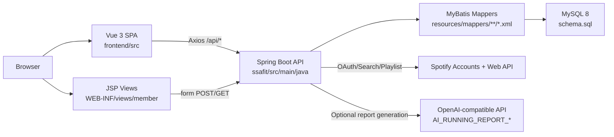
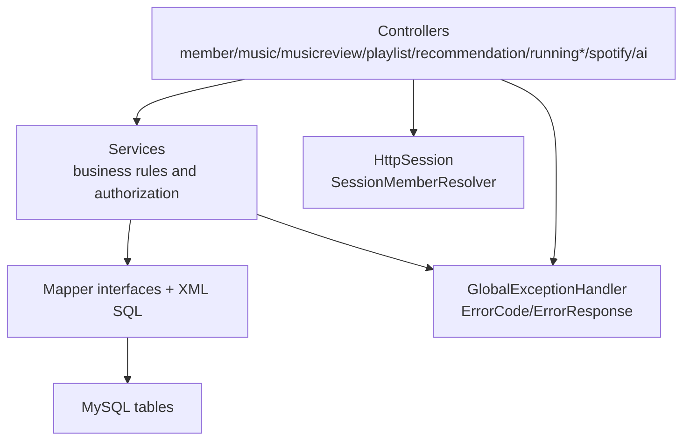
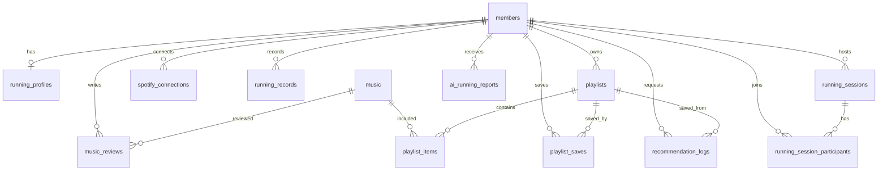
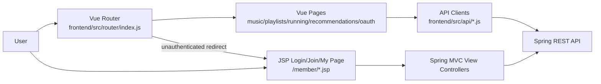
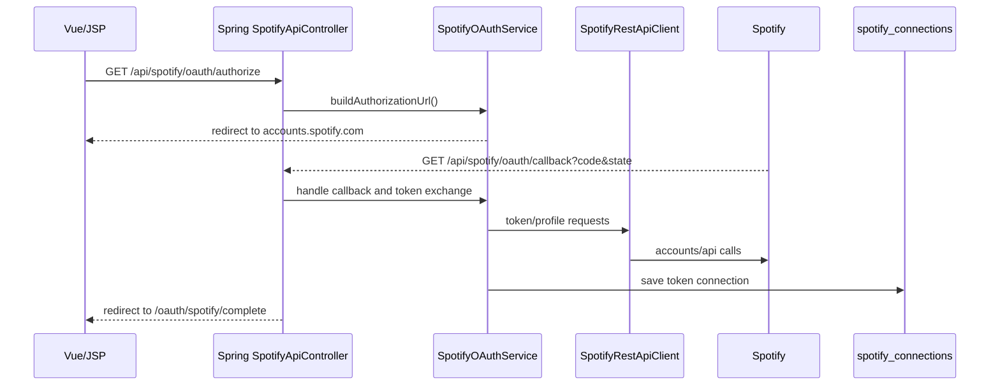
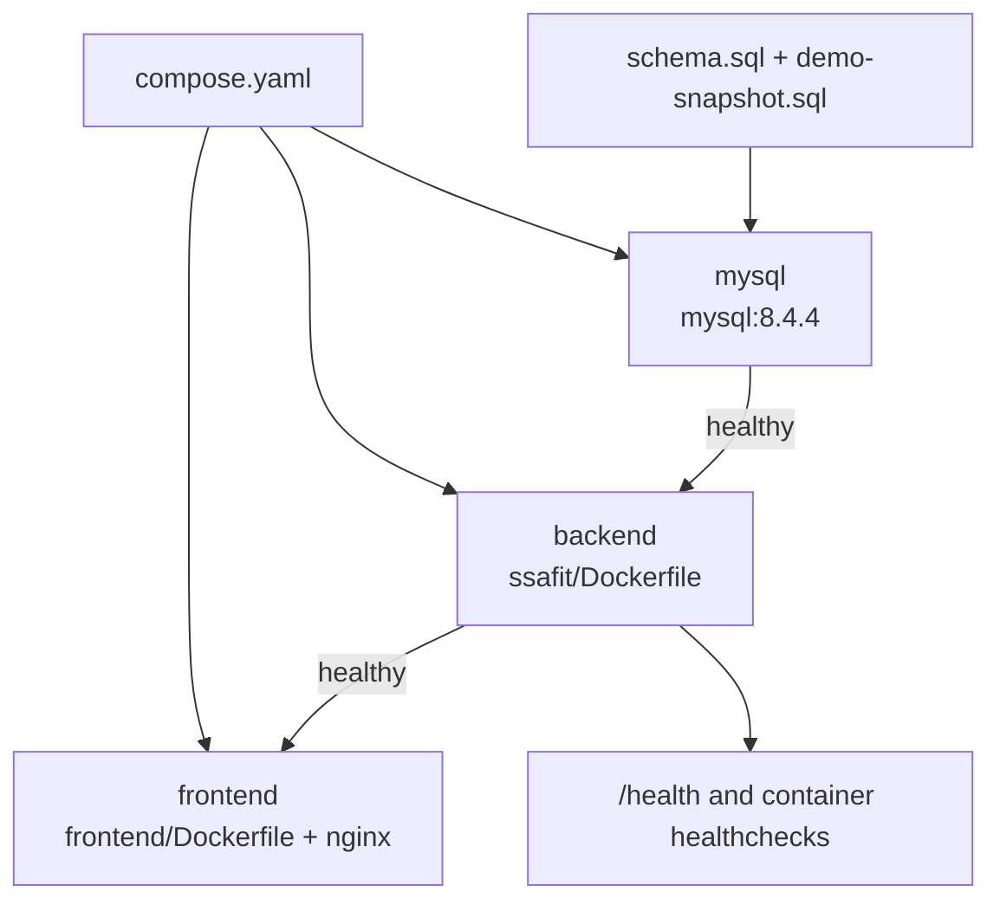
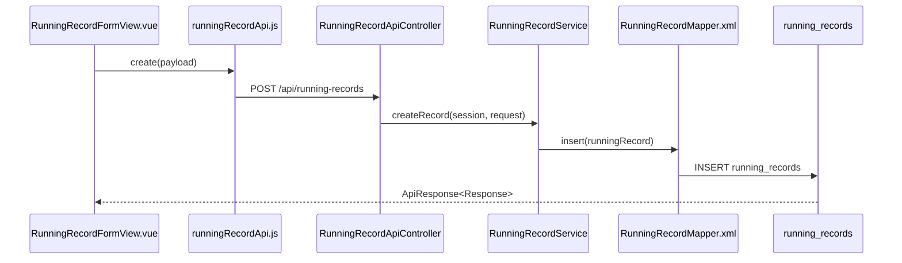
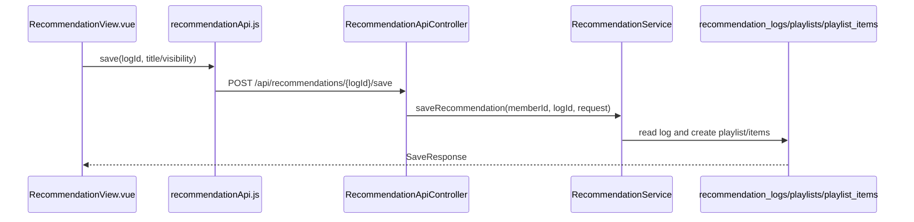
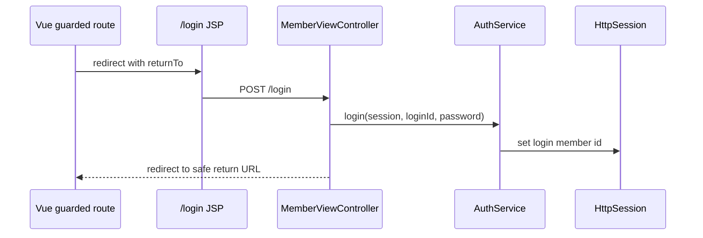

# Architecture As-Is Evidence

Generated from the current `develop` checkout on 2026-06-25.

## Overall Runtime

## Backend Flow

Representative backend evidence:

- `SsafitApplication.java`: explicit `@MapperScan` allowlist for `airunningreport`, `member`, `music`, `musicreview`, `playlist`, `recommendation`, `runningprofile`, `runningrecord`, `runningsession`, `spotify`.
- API controllers: `MemberApiController`, `AuthApiController`, `MusicApiController`, `MusicReviewApiController`, `PlaylistApiController`, `RecommendationApiController`, `RunningRecordApiController`, `RunningSessionApiController`, `SpotifyApiController`, `AiRunningReportApiController`.
- JSP controllers: `MemberViewController`, `RunningProfileViewController`, `SpotifyLoginViewController`.
- Session authentication: `AuthService`, `SessionConst`, `SessionMemberResolver`.

## Database Flow

Database evidence:

- `schema.sql` creates `members`, `running_profiles`, `music`, `music_reviews`, `playlists`, `playlist_items`, `playlist_saves`, `recommendation_logs`, `ai_running_reports`, `spotify_connections`, `running_records`, `running_sessions`, `running_session_participants`.
- Status/check values include `members.status` (`ACTIVE`, `INACTIVE`, `SUSPENDED`, `WITHDRAWN`), `playlists.spotify_export_status` (`NOT_EXPORTED`, `PENDING`, `SUCCESS`, `FAILED`, `PARTIAL`), `ai_running_reports.status` (`PENDING`, `COMPLETED`, `FAILED`), `running_sessions.status` (`OPEN`, `CLOSED`, `CANCELLED`).
- Soft delete is used for `members`, `playlists`, and `running_records` through `deleted_at`.

## Frontend And JSP Split

Vue routes confirmed in `frontend/src/router/index.js`:

- `/music`, `/music/:musicId`, `/music-manage/new`, `/music-manage/:musicId/edit`
- `/playlists`, `/playlists/saved`, `/playlists/new`, `/playlists/:playlistId`, `/playlists/:playlistId/edit`
- `/running-records`, `/running-records/new`, `/running-records/:runningRecordId`, `/running-records/:runningRecordId/edit`
- `/running-sessions`, `/running-sessions/new`, `/running-sessions/:runningSessionId`, `/running-sessions/:runningSessionId/edit`
- `/recommendations`, `/oauth/spotify/complete`, `/login-required`, `/login/spotify`, `/access-check-failed`

JSP routes confirmed in view controllers:

- `MemberViewController`: `/join`, `/login`, `/logout`, `/members/me`, `/members/me/identity`
- `RunningProfileViewController`: `/members/me/running-profile`
- `SpotifyLoginViewController`: `/login/spotify`

## External API Flow

Spotify evidence:

- Config: `application.yml` has `spotify.client-id`, `client-secret`, `redirect-uri`, accounts base URL, API base URL, scopes for private read and playlist write.
- Client: `SpotifyRestApiClient` uses Spotify HTTP endpoints.
- Services: `SpotifyOAuthService`, `SpotifyService`, `SpotifyPlaylistImportService`, `PlaylistExportService`.
- DB: `spotify_connections`, Spotify metadata columns on `music`, export status columns on `playlists`.

AI report evidence:

- Config: `ai.running-report.*` in `application.yml` and `application-docker.yml`.
- Provider: `OpenAiRunningReportProvider`.
- API: `GET /api/ai/running-reports/latest`, `POST /api/ai/running-reports`.
- DB: `ai_running_reports`.

## Docker Flow

## Actual Request Flow Examples

### Vue Running Record CRUD

### Vue Recommendation Save To Playlist

### JSP Login Then Vue Return

