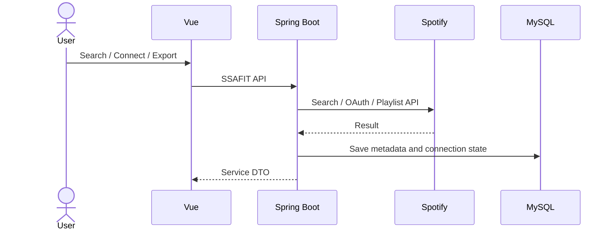

# Spotify Integration

## Purpose

Spotify 연동은 내부 음악 데이터만으로 끝나는 서비스를 사용자의 청취 환경까지 연결하기 위해 사용합니다.

지원 범위:

- 곡 검색
- Spotify 트랙의 내부 음악 저장
- OAuth 계정 연결
- 사용자 Spotify 플레이리스트 조회
- Spotify 플레이리스트 가져오기
- 내부 플레이리스트 내보내기

## Architecture



Frontend는 Spotify API를 직접 호출하지 않습니다. Client Secret과 사용자 토큰은 Backend 경계 안에서 처리합니다.

## Search

검색 결과에서 Track ID, URI, 제목, 아티스트, 앨범, 이미지, 외부 URL 등의 메타데이터를 사용합니다.

Spotify의 tempo 또는 artist genre 보강은 실패할 수 있으므로, 해당 값이 없더라도 검색 자체를 실패시키지 않습니다. BPM과 장르는 nullable 메타데이터로 처리됩니다.

## OAuth

```text
SSAFIT 로그인
→ Spotify 연결 요청
→ Session에 OAuth state 저장
→ Spotify 동의 화면
→ callback code/state 검증
→ access/refresh token 교환
→ Spotify 사용자 확인
→ spotify_connections 저장
```

OAuth state는 callback 검증 후 소비하며 재사용하지 않습니다.

## Token Refresh

Spotify API 호출 직전 연결 정보를 확인하고 Access Token이 만료되었거나 만료가 임박하면 Refresh Token을 이용해 갱신합니다. Refresh 응답에 새 Refresh Token이 없으면 기존 값을 유지합니다.

## Playlist Export

```text
NOT_EXPORTED
→ PENDING
→ SUCCESS

PENDING
→ FAILED
```

내보내기 전에 다음 조건을 확인합니다.

- 로그인 사용자가 플레이리스트 소유자인지
- Spotify 연결이 존재하는지
- 사용할 수 있는 Access Token이 있는지
- 수록곡에 Spotify URI가 있는지

Spotify Playlist 생성 이후 곡 추가가 실패할 수 있으므로 외부 Playlist ID와 URL이 이미 만들어진 부분 실패 상황을 구분합니다. 외부 객체가 생성된 상태에서는 무조건 자동 재시도하지 않아 중복 Playlist 생성을 방지합니다.

## Security Boundary

API 응답과 로그에는 다음 값을 노출하지 않습니다.

- Access Token
- Refresh Token
- Authorization Code
- Client Secret

실제 Secret은 환경변수로 주입합니다.

현재 DB에는 Spotify Access Token과 Refresh Token 저장 컬럼이 존재합니다. 운영 환경으로 확장할 경우 애플리케이션 수준 암호화나 별도 Secret/KMS 계층을 추가하는 것이 필요합니다.
